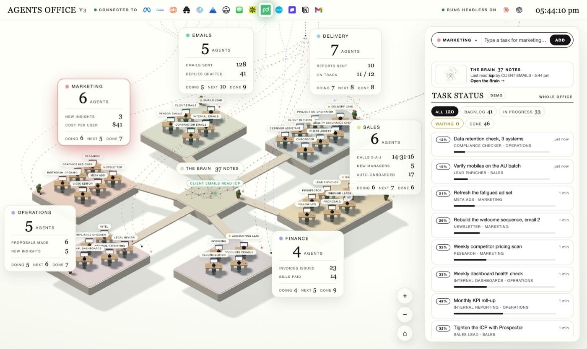
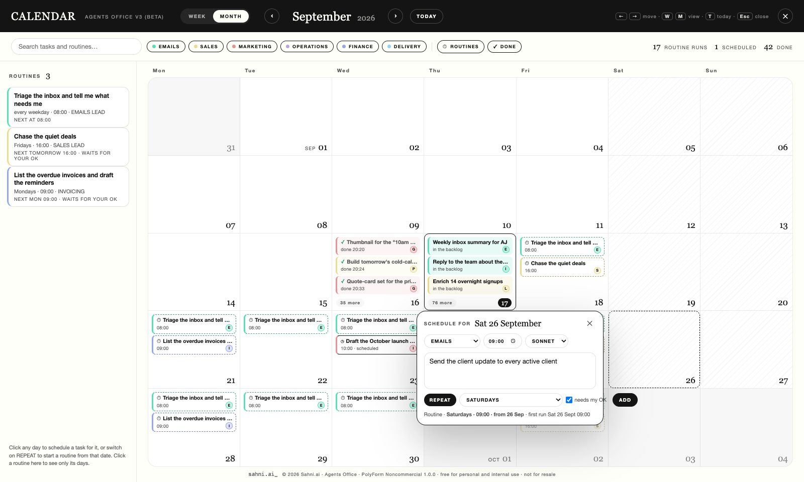

# Agents Office



A 3D isometric office where AI agents do real work on your own Claude login.

Six departments, thirty-five agents at their desks, a task bar that routes what you type to the
right agent, and a Brain at the centre that is your own folder of notes. 

Type a task, the office
gives it to the right person, they read your notes, use the connectors you have already set up
in Claude Code, do the work, and file the result back into your notes. Everything runs on your
machine.

**Beta.** It works end to end. Expect rough edges and tell us about them in Issues.

> **Abrinay · PanaClaw** (https://panaclaw.com): interfaz en español, configuración para el negocio
> PanaClaw (brain en `brain-panaclaw/`, 35 puestos, skills y rutinas) y la oficina servida sin
> simulación de demostración. El producto original, su marca y su licencia son de Sahni.ai.

**License, in plain English:** Agents Office is a Abrinay product. It is free for personal and
internal use. You may not sell it, resell it, or build a paid product on it. You may not rename it,
rebrand it, strip the Abrinay mark or the notices, present it as your own, or wire it into or bundle
it with another product, agent system or workforce. (Formal terms: PolyForm Noncommercial 1.0.0 plus
Abrinay additional terms — see [LICENSE](LICENSE).) The page carries the Sahni.ai mark at the
bottom-left and a licence line along the bottom; leave them in place.

## Latest updates

- **Update the Brain's connections, by hand** — 27 Oct 2026 · In the cloud office, **Cerebro → Herramientas → «🔄 Actualizar conexiones»** (administrators only; on the phone, a chip of the same name). It never runs by itself. Step 1 cleans the map for free: the neurons of notes you deleted leave with their lines, the neighbours' sizes are corrected, what the agents learned from deleted notes is forgotten, and links that point to a note that no longer exists are listed (your note texts are never edited). Step 2 asks the AI (Ajustes → Modelos → «Conectar notas del Cerebro») which existing notes your new or edited notes should link to, for a few cents; you tick what you want, it is written as a «Relacionadas» section at the end of that note, and you can undo it. The 59 factory notes and the key notes are never written to. A third, free step offers the pairs of notes your agents used together in approved work, and the gold «learned» synapses now show on the cloud map too. A fourth step **recalculates the whole 3D map in the cloud** (every neuron may move; the previous map is kept so you can go back; up to 1,500 notes). A sixth step, off until you measure it, lets the agents also search the Brain **by meaning** (the same idea in other words), with a meaning vector per passage. A fifth step **flags notes that say almost the same thing and figures that contradict each other** (a price, a percentage, a delay stated differently in two notes; a factory note wins over yours; the AI can confirm, with your click; nothing is changed for you). The Brain's search is now **measured** (`node scripts/evals-cerebro.mjs`: 54 questions, recall@5 90.7 %) so any change that makes it worse is caught. See CLAUDE.md → «Actualizar conexiones del Cerebro».
- **A chat with Dimitri of your own** — 27 Oct 2026 · In the cloud office every administrator now has **their own conversation** with Dimitri — their chat, their history and their session summary — and nobody can read anyone else's, not even by opening it from the history. The header says «🔒 solo tú ves este chat», shows this month's AI spend against the budget, and the history lets you **rename** a saved conversation (desktop and phone). Over Telegram each person uses the chat of their own account. A new note with `[[links]]` to notes already on the map now arrives connected instead of floating alone.
- **Dimitri, audited: he looks things up, speaks plainly and shows his work** — 27 Oct 2026 · Dimitri now has a built-in guide to the whole office (45 topics: how a task is created and adjusted, how content is published, every Estudio setting, where each boss's skills and library live…) and, in the cloud, **18 read-only look-ups** (tasks and their log, who did what, agents, the Brain, content, ads, the gallery, costs, the connectors that read) so he finds things instead of guessing; you watch each step while he thinks and keep «Consulté N cosas» under the answer. He speaks like a person on a chat — the answer first, plain words, about 120 words — and the Monday summary is now ≤ 110 words with no headings. He tells you which AI he runs on (and where to change it: Ajustes → Modelos). He still never approves, sends, publishes, pays or deletes. Audit and plan: `docs/auditoria-dimitri-2026-10-27.md`.
- **The Brain can be written** — 27 Oct 2026 · «✎ Nueva nota» writes a note without uploading a document; every note has **Editar** (it never overwrites what someone else changed) and **Mover a la papelera** (30 days, it returns to its folder), on the desktop and on the phone, locally and in the cloud. Dimitri can create a note or add to one («añade a la nota *precios* que…») — your click, and DESHACER.
- **Dimitri knows your team and who is writing to him** — 26 Oct 2026 · Ask him «hazle a Avalon una lista de tareas para el cierre de octubre» and he now sees the people of the platform (accounts with their role, plus Ajustes → Equipo, with how many open tasks each has) and who is chatting with him (the account, or the person whose Telegram it is). A plan can send a piece **to a person** — with its steps, priority, deadline, «waits for…» and project — and ENVIAR A LOS JEFES leaves them in that person's list (Tareas → Mías) and in your Delegadas. «Pásale a Avalon lo de cobrarle a Sol» works too, with DESHACER. Dimitri still only proposes: nothing is created until you press the button.
- **Assign a task to anyone on the team, and «Mías» that is yours alone** — 26 Oct 2026 · «Quién la hace» (the field at the top of Tareas, the task panel's menu, the phone's add bar, the calendar's new-task sheet and the project's add-task sheet) now offers **Para mí**, the **people of the team** — the accounts of the cloud (administrators, editors…) and those in Ajustes → Equipo — and an **agent of each department**. A task given to a person is theirs: it shows in *their* Mías, they start it, tick it done, delegate it; you follow it in **Delegadas** and they are told. «Delegar…» on one of your tasks lists the same people. In the cloud every account has its own Mías (what is assigned to you, and — for administrators — the owner's list from Telegram and Dimitri); a name «Tú» is reserved. On the phone, the **Estudio** can now **create, rename and delete folders** and **organise pictures**: «Seleccionar» several and «Mover a…», or move one from the viewer; every move says what happened and has DESHACER, deleting a folder never deletes pictures, and new images land in the open folder. `node scripts/tareas-asignar-recorrido.mjs` and `node scripts/movil-carpetas-recorrido.mjs` check both in a phone browser. See CLAUDE.md.
- **A phone version of its own** — 25 Oct 2026 · On a phone (≤ 820 px) the office is no longer the desktop squeezed in: it opens as an app — a bottom tab bar (Inicio · Tareas · Calendario · Dimitri · Más), a compact header with the ⚠ approvals badge, bottom sheets instead of windows, big checkboxes, swipe to complete, a bottom «add task» field that understands dates and #tags, a day-by-day agenda, and Dimitri's chat full-screen. **Contenido** (agenda, week and month, the queue with its approve-in-three-taps drafts, the Meta inbox with a full-screen thread and a second-tap send, the 3:4 profile grid) and a full-screen step-by-step **Create post** (where · what · media from the phone or the Estudio gallery · when, with a per-network preview and a problems light), **Analíticas** (account picker, touch chart, compare accounts, boost) and **Anuncios** (campaigns with a worded switch, suggestions, creatives, the 5-step wizard; anything that spends keeps its two taps with the figure) have their own phone screens, in a second on-demand package (`dist/movil-d.js`). Everything else (Cerebro, Estudio…) opens from «Más» inside a frame with «Volver» until it gets its own phone screen. It is a separate package (`dist/movil.js`) the page asks for only on a phone; the desktop does not change. Switch it in Ajustes → Apariencia → Versión. See CLAUDE.md → «La versión móvil».
- **Contenido: choose the account each piece goes out on** — 9 Oct 2026 · When your Meta token sees several Facebook pages and Instagram accounts, the piece editor has **«Publicar en»**: for Instagram and Facebook, the account it goes out on is always in sight («Sale en @pana.claw»), and «Cambiar» lists the others with their picture and @user; one that cannot publish (an Instagram with no linked Facebook page) says why and cannot be picked. A new piece starts with the one in Ajustes, so nothing changes for whoever does not choose. Changing the account of an approved piece takes its OK away (it is part of what goes out). Meta direct publishes on that page and that Instagram, with that page's token; Metricool only on its brand's accounts, and says so. Every card, the hover preview and Programación name the account, and the calendar filters by account (remembered). Agents can pass `cuentas` in `crear_borrador` and see it in `ver_calendario_contenido`. `GET /api/contenido/cuentas`.
- **Analíticas, one account at a time** — 9 Oct 2026 · With several Facebook pages and Instagram accounts, pick one (with its picture or initial, grouped by network; a dropdown on a phone): every figure, the trend line, formats, best hours and top posts become **that account's own**, and the screen says which one you are looking at. With several, it sums them and says how many. **Comparar cuentas** puts every account in one sortable table (followers and growth, reach, interactions, posts); a click on a row picks it. The month's report can be made for one account, and agents' `ver_analiticas` takes an account too (and, without one, adds a line per account).
- **Meta ads, phases A6 and A7: measure, and the month's report** — 9 Oct 2026 · Anuncios → Summary → **Medir**: «Crear indicadores» adds this month's ad spend and the 30-day cost per result to «Cómo va el negocio» (key N), kept up to date by every read of Meta (one point a day); **ROAS** is only created with a pixel and measured purchases — otherwise the panel says why (a ROAS of 0 without a pixel would lie). The **ads report of the month**, built by the office from its own data with no model: spend, each campaign's results and cost per result, the best creatives, the suggestions you applied and what happened after, and what was paused or activated; «sin datos» where it does not know, and «so far» for the current month. It opens in a window with a month picker and «Guardar en el Cerebro» (`Agents Office/informes/AAAA-MM anuncios.md`, never pushed), the Monday summary quotes last month's, and agents read it with `ver_informe_anuncios`. The page did not grow.
- **Meta ads, phase A6: the Conversions API** — 10 Oct 2026 · Off by default (Ajustes → Anuncios). When on, the office tells Meta what was sold and who is a real lead, server to server: a Stripe payment trigger becomes a Purchase with its amount, a form trigger a Lead, your shop or Zapier can post to its own webhook (with `AO_HOOK_TOKEN` and your pixel's `event_id` to deduplicate), and in a private conversation of the Bandeja you mark «Registrar venta» or «Registrar contacto calificado» (Messenger or Instagram, sent as `business_messaging`). Email and phone are SHA-256 hashed before they are stored; nothing personal is shown or logged. Only the owner sends events; agents never do. Transient Meta errors retry on their own; Anuncios → Medir shows on/off, today's events and the last error, with «send a test event»; Ajustes → Estado has a «Conversiones» line; ROAS can come from the sales registered here when the pixel has none, and says so.
- **Meta ads, phase A4: boost what already went out** — 9 Oct 2026 · A published piece in Contenido (and each of «Las que más movieron» in Analíticas) has an **Impulsar** button: it opens Anuncios → Borradores with a campaign draft whose creative **is that post** (its picture or video and its text, with the likes it already earned; you only pick the button), «get messages», Advantage+, US$5 a day for 7 days by default. Before creating, the office asks Meta whether the post can be boosted (posts with licensed music, interactive stickers or IGTV cannot) and says why if not; it is created **paused** like any other, and activating it still takes your two clicks. The «boost» suggestion of phase A5 now works too. With the real token, the eligibility fields are still to be checked.
- **The inbox with Meta, phase B2: private messages** — 9 Oct 2026 · Instagram and Messenger conversations reach the Bandeja as threads (each message with its time; images shown only if they come from Meta). The **24-hour window** is always in sight («you can reply for 5 h more»); once it closes the office will not send (the server refuses it without calling Meta, no message tags) and says why — a new message from the customer opens it again. Replying stays yours, once, under 1,000 characters with a counter; the agent drafts. Without Meta's advanced access (required to read customers' messages) a banner says what is missing; comments keep working. Telegram tells you of new messages with the time left. The conversation view ships in the editor bundle, so the page grew only 4.9 KB.
- **The inbox with Meta, phase B1: comments** — 9 Oct 2026 · Instagram and Facebook comments reach the Bandeja straight from Meta (no Metricool needed), including those on **your ads** (marked «EN UN ANUNCIO», with a button to that campaign in Anuncios), each with the post it came from and the comment it answers. Replying stays yours — a second click, sent **once** even if the office stops mid-send —; you can **hide or show** a comment (never delete), with DESHACER; a hidden comment cannot be answered and the inbox says so. The agent drafts replies and may **suggest** hiding one. Ajustes → Contenido → «La Bandeja trae de»: Meta, Metricool or both (by default Meta when there is a token), never shown twice. Telegram tells you about new comments at most once every 15 minutes. With the real token: `node scripts/check-meta-bandeja.mjs` (reads only).
- **Meta ads, phase A5: the AI that improves campaigns** — 9 Oct 2026 · After each read of the figures the office reviews your campaigns with the plan's rules — leave alone what is learning, wait before judging, cut what spends without results, new creatives when an ad tires (never more budget), scale +20 % what works (at most every 72 h), merge ad sets stuck learning, fix what Meta rejected (the corrected text as a draft), boost what did well organically — and shows each as a card in a new **Sugerencias** tab: the figure that motivates it, why, the exact change, the expected effect and the risk, with Apply · Dismiss · Remind me in 3 days (what spends still takes your two clicks). The thresholds live in the Library (`biblioteca/marketing/campanas-pagadas/umbrales.json`, each with the sentence it comes from), not in the code; you can override them in your Brain. A **Creativos** tab rates each creative in words. An optional autopilot (off) only ever **pauses**. Telegram offers one scale-up a day with two taps; the ads agent gets a Monday review routine; what you applied is measured 7 days later and teaches the Brain's memory.
- **Meta ads, phase A3: build campaigns in the office, always paused** — 9 Oct 2026 · A **Borradores** tab with a 5-step wizard (objective in plain words — «let them message me on WhatsApp», web visits, sales, leads, awareness —; audience, Advantage+ Panama 18+ by default, with the special-category question always asked; budget and dates with the maximum cost in words; 3–6 creatives from the gallery or «Crear con el Estudio» for the ad, with «✨ Mejorar» by the ads agent and Meta's automatic enhancements one by one; review, where each problem takes you to its field, a preview, and **«Crear en Meta (en pausa)»**). The office creates images, videos, creatives, campaign, ad set and ads in order, all **paused**, logging each step, and reconciles by its own tag after a crash so it never creates twice; on failure it archives what that attempt made. Your per-campaign cap travels to Meta as `spend_cap` when it is US$100 or more (Meta's minimum). Meta's own preview is only ever shown as a sandboxed `<iframe>` of facebook.com. Dimitri, your assistant and the ads agent may leave drafts; creating in Meta is your click. With the real token: `node scripts/check-meta-anuncios.mjs --crear-pausada`.
- **Meta ads, phase A2: control from the office** — 9 Oct 2026 · What lowers spend is one click with DESHACER: pause a campaign, ad set or ad, lower a budget, archive. What spends — activate, resume, raise a budget, extend the end date, relaunch — takes **two clicks, and the second one states the figure** («Sí, activar — up to US$15 a day, US$105 this week»). The **server** enforces it (a 2-minute, single-use token tied to that action and amount) and re-checks your caps (day, month, campaign) before applying; Meta validates first (`validate_only`). Raising more than 20 % an ad set that is learning warns it restarts learning. Relaunch duplicates a finished campaign **paused**. A History tab says who changed what. Dimitri proposes (his card shows the figure and asks for your second click), Telegram `/anuncios` pauses with one tap and activates with two, your assistant may only lower spend, agents may do nothing.
- **Meta ads, phase A1: the Ads panel, read only** — 9 Oct 2026 · A megaphone in the top bar (key **J**; in «⋯» on a phone) opens **Anuncios**: a Summary (alerts for unpaid account, rejected ads or a cap close to being hit; today's spend against the daily cap, the month's against the monthly one, 7-day results and their cost, the active campaigns), a Campaigns table that unfolds campaign → ad set → ad (status in words, learning phase, budget, spend, results and cost per result by objective — «12 conversations at US$1.40» —, CTR, frequency, end date; filters and date range; a side panel with the creative, the audience and Meta's review) and a History tab. The office only reads from Meta (GET and batches of 50, paced and braked), alerts on rejected ads, unpaid accounts and 90 % of the daily cap (Telegram too), and keeps ad spend apart from model costs («Publicidad» in the Monday summary and in Costos). Dimitri, the Marketing agents (`anuncios-mcp.mjs`, read only) and your own assistant (`ver_anuncios`) can read it. Own bundle (`dist/anuncios-vista.js`); the page grew 3.4 KB. With the real token: `node scripts/check-meta-anuncios.mjs` (reads only).
- **Meta ads, phase 0: the groundwork** — 8 Oct 2026 · The office talks to Meta on **Graph v26.0** (from v23.0, whose Marketing API side expired on 9 Jun 2026), with a dated table of versions: `npm run check` warns 90 days before the pinned one dies. Facebook reach moves to `page_total_media_view_unique` (Meta retired `page_impressions_unique` in v25). A **usage brake**: the office reads Meta's usage headers on every answer and, when Meta throttles, stops calling for as long as Meta asks (5 min if it does not say) — publishing, Analíticas, ads and the inbox all share it. **Ajustes → Anuncios** holds the ad account, page, Instagram, pixel and WhatsApp ids and the spending caps (US$20 a day, US$300 a month, US$150 a campaign by default; no secrets there). «Comprobar conexión» says what the token lacks **per function** (Analíticas, publishing, ads, messages), and Ajustes → Estado has rows for ads and Meta messages. One fake Meta for every test (`tests/meta-stand.mjs`), which already answers the Marketing API and the inbox. The ads panel itself comes in phase A1 (`docs/plan-meta-anuncios-y-bandeja-2026-10-09.md`).
- **Dimitri, the agents and your own AI in control of the calendar and the tasks** — 9 Oct 2026 · Dimitri can now pause, resume, change or run a routine right now, raise a task's priority or move its deadline, delegate one of **your** tasks or tick it done, retry what failed, and fill the week in Contenido — each one a card that waits for your click and can be undone. He sees the tasks calendar you have open, how what you approve goes out (mode, Instagram's quota, failures) and how last week's posts did, and he tells you what he wanted to do and could not, instead of dropping it. Your own tasks are never moved or cancelled like an agent's anymore, and an agent can no longer rewrite a piece that waits for your OK. The agents can read the routines, what went out with its numbers and the empty days. And **any AI of yours on this computer** (Claude Desktop, Claude Code, Cursor, LM Studio…) can run the office through `oficina-mcp.mjs`: it reads everything Dimitri reads and makes the same changes, with a key to undo them, but it can never approve, send, publish, pay or delete. Dimitri's answer is now read whichever model writes it (Meta Muse Spark included). ChatGPT and Meta AI on the web need a login first (issue #2). Guide: [docs/conectar-ia.md](docs/conectar-ia.md) · coverage: [docs/auditoria-control-dimitri-agentes-2026-10-09.md](docs/auditoria-control-dimitri-agentes-2026-10-09.md).
- **What went out teaches the Brain (F4)** — 9 Oct 2026 · Once a post has had five days, the office ranks it among the others by its interactions; when an agent wrote it, the notes that agent cited move closer (it worked) or further (it did not), so the next drafts lean on what your audience answers to. Monday's report now has a paragraph on the networks: what went out and how it did, the best and the worst, the empty days ahead and what could come back.
- **What already went out, filling the week, templates and approving from the phone (C2, C3)** — 8 Oct 2026 · The Contenido calendar now shows **what was published, with its numbers**: each piece that went out adds its reach and interactions (matched with what Analíticas reads from Meta), and posts made by hand show as read-only cards with their link («Publicado fuera»). The best hours can be shown for **one network**, the **time zone** is in sight, and with Meta direct you see **Instagram's daily quota**. **«Llenar la semana»** finds the days with nothing on your networks, each at its best hour, and fills each one with a new draft from Marketing (with an Estudio image) or with **something that already worked** coming back (never twice within 8 weeks); you approve them one by one or all at once in «Borradores de la semana». **Post templates** are Brain notes (`Contenido/Plantillas`): «Guardar como plantilla» on a piece, «Desde una plantilla…» under «+ Crear». And on Telegram, **`/contenido`** (or an agent's new draft) brings each piece with its photo and ✅ Aprobar.
- **Marketing looks at your photos and videos (28 Oct 2026)** — «✨ Mejorar con Marketing» now *sees* what the post carries: your browser sends reduced copies of the photos (and a few frames of each video — it cannot hear the sound) and the agent writes from what it sees, saying in one line what it looked at; it works with only a photo and no text. The Estudio's agents get a read-only `ver_imagen` tool for gallery photos (up to 6 per task; videos are not read there). A model that cannot see images (Meta Muse Spark) is never pretended to: the screen says so. See «Los agentes MIRAN fotos y videos» in CLAUDE.md.
- **A piece editor you write in first, and cards you read at a glance (C1, C2)** — 8 Oct 2026 · The Contenido panel was rebuilt after comparing it with Metricool. Each network has its own **format** (the same video as a Reel on Instagram and a Post on Facebook), and the rules check each one with its own. You write in **one box** with the pictures inside (drag to reorder) and a bar: emoji, hashtags (your saved sets and the ones you use most), first comment, link, **saved texts** (your sign-off, a call to action — a Brain note, `Contenido/Textos guardados.md`) and **✨ Mejorar con Marketing**, where your content agent proposes the text in the brand's voice and you decide. «Editar por red» puts tabs on the same box; each network has a live counter. Network settings and notes fold away and open by themselves when something is missing; «N problemas» unfolds with its one-click fixes. The footer keeps when it goes out and **Aprobar ▾** (send to review, back to draft, **Publicar ya** — out in about 5 minutes). The preview shows phone or computer. On the calendar, a card shows the text under the title, «+N» on the thumbnail and the format of a network that differs, and hovering (or tabbing) shows the post's preview. The editor loads on its own (`dist/pieza-editor.js`), so the page is lighter than before.
- **Publish straight to Instagram and Facebook with Meta (F3)** — 8 Oct 2026 · Ajustes → Contenido → «Meta directo»: what you approve in Contenido goes out through Meta, no Metricool, with the same token as Analíticas (plus the publishing permissions). **Facebook** is scheduled in Meta and goes out on its own, even with this computer off. **Instagram cannot be scheduled through Meta's API**, so the office publishes it at its time from this computer (it prepares the post 15 minutes before and uploads any video; up to 30 minutes late it still goes out, later it fails and says why). It never publishes twice, the first comment goes out right after, and the token never touches a file. Step by step, and a test that publishes nothing: [docs/conectar-meta.md](docs/conectar-meta.md) and `node scripts/check-meta-publicar.mjs`.
- **Your own tasks everywhere, and the office's health in Ajustes** — 8 Oct 2026 · Click a day in the calendar (P) and the first choice is now **PARA MÍ**: a task of yours on that day (all day in the month, the hour you clicked in the week, REPEAT every day, week or month), with no agent, model or team. The task panel (T) has **PARA MÍ** at the top of its department menu («firmar el contrato para el viernes !alta») and a line **«Lo tuyo hoy · N»** that opens Tareas → Mías → Hoy. In Mías, **Hoy** puts the overdue ones apart and on top, **Próximos 7 días** has a heading per day, and **Delegadas** keeps what an agent could not do (it used to show as done). The calendar's TUYAS layer now refreshes when you open it and every 30 s. **Estado de la oficina** is no longer a dock button: it is the first tab of **Ajustes** (key O still opens it), and the gear shows a dot only when something is amber or red — then the gear opens on Estado.
- **La Biblioteca de habilidades: 50 métodos de marketing, en español** — 7 Oct 2026 · The marketing department (and the desks of Sales, Emails and Delivery that share the work) now has a library of 50 working methods adapted from [marketingskills](https://github.com/coreyhaines31/marketingskills) (MIT, Corey Haines): marketing plan, copywriting, paid campaigns, ad creative, SEO and AI search, social, email sequences, pricing, offers, launches, referrals, PR, A/B tests and more — in Spanish and for any business, not only software. An agent sees the short index of its own, the one that fits the task comes in whole, and the rest (with templates and checklists) it reads when it needs them, so a task never carries all 50. What is yours — positioning, ideal customer, objections, your customers' words — lives in the Brain as the note **contexto-marketing**, which **Ajustes → Preparar desde mi web** now writes too. Each agent's sheet (✎) lists its methods. Your own version of one goes in `<cerebro>/Agents Office/biblioteca/<id>/` and wins.
- **Your own tasks, beside the agents' (plan D)** — 7 Oct 2026 · The office now counts you as someone who works too. Tareas (H) opens a new first tab, **Mías**: your lists on the left — **Bandeja** (no date, no project), **Hoy** (due today, overdue, what you are doing), **Próximos 7 días**, **Todas** (grouped by date), **Delegadas** (what you passed on, until it comes back) and **Hechas** — plus your projects, each with its count. Each row has a round checkbox to tick it done (with DESHACER), each list ends with «+ Añadir tarea» that already carries that list's date or project and a folding «COMPLETADAS · N», and **Tablero** shows them as Por hacer · Haciendo · Hecha. Type «Para mí» in the top field (it is the default in Mías) and it is yours — no router, no desk. From one of your tasks: **▶ Empezar** (your stopwatch runs), **Delegar…** to an agent (the one you pick, the one who had it, or the one the office picks) or to a person of the team, with a note — follow it in Delegadas; from an agent's task: **«Lo hago yo»** (or «Lo termino yo» on a draft waiting for your OK) and it moves to your list with whatever the agent had left. The agents see your tasks as **«DEL DUEÑO»**: they do not run or change them, they wait for one when their work depends on it, and they can **suggest** something only you can do — it lands in your Bandeja to accept or drop. Dimitri reads your list, can put a piece of a plan on **you**, and Inicio, the calendar (a **TUYAS** layer) and Telegram (`/mias`, `/yo llamar al banco el viernes`) show it too. Ideas from TaskView, none of its code. Plan: `docs/analisis-tareas-del-dueno-2026-10-07.md`.
- **Tareas: the work in order (T0–T6)** — 6 Oct 2026 · A new view, **Tareas** (key **H**, or the checklist in the dock; on a phone, in «⋯»). **Inicio** shows what waits for your OK, today and what is overdue, what the agents are doing step by step, what is blocked and why, the next days, the agents' ideas and what got done — sections that fold and remember it. **Lista** has filters you can see as chips (they live in the address, so a link keeps them), sorting, grouping and changing several tasks at once with DESHACER. **Tablero** is by state, with a lane per department if you want: drag a card to ask for an idea, approve, close or repeat — always undoable, never a «¿seguro?». **Proyectos** cross departments (a launch: photos, post, email, product page) with a goal, a date, progress and a **map** of what waits for what; **Medidas** shows done on time or late, how long a task takes, how long it waits for your OK — click a figure to see its tasks. A task now has **priority, tags, a deadline** (apart from when it starts), an **estimate**, **steps** the agent ticks as it goes (the progress bar is real now), and **«waits for»** another task. The quick add understands «urgente: propuesta para Acme para el viernes #ventas». The agents get their own tools: see their task, tick steps, log notes, **ask for a block** when something is missing (you get a «Para ti: …» task and theirs resumes by itself), propose work to another department as an idea, and log work done outside a task — nothing there approves or sends. Dimitri plans **projects** with priorities, dates and the order between pieces. Routines can be **monthly** («el segundo martes de cada mes», «el último día»), stop on a date or after N times; a task can **repeat** («cada semana», fixed or from when it was done); deadlines warn the day before and when overdue; a project running late says so. People get a stopwatch; webhooks tell Zapier/Make/n8n (signed, https only). Underneath, one module (`tareas/`): one way a task is born, a log of every change and who made it, and a run that no longer overwrites a comment you made while the agent was working. Ideas from TaskView, none of its code. Plan: `docs/analisis-taskview-2026-10-06.md`.
- **Dimitri and the agents use the presets** — 2 Oct 2026 · Tell Dimitri «convert these 40 warehouse photos into web catalog shots» or attach an Excel: he picks presets and a 3D scene, shows the batch with its cost, and only runs it when you press TRY 3 or GENERATE ALL; the batch card follows each photo live. If the real cost per row is higher than the button said, it asks for a second click. Department agents can search and apply presets and create batches; a big one waits for your OK in Approvals. The 53 video presets are in the catalog (their screen comes next). The bank, batches and 3D stage load when you open the Estudio, so the office still opens light.
- **Básico · Avanzado** — 2 Oct 2026 · Images in the Estudio have two modes, a switch under «¿Qué quieres crear?» that is remembered: **Básico** is the plain composer (model, idea, format) and does not even download the preset bank; **Avanzado** adds the presets and the 3D scene. In both, the model and the format are always in sight and always yours: the bank never swaps them, the 3D frame follows the format, and if the model cannot do the recipe the reason shows next to GENERAR. Results go only to the gallery.
- **Banco de presets (F1): edit a product photo by stacking presets** — 1 Oct 2026 · In the Estudio (Avanzado), press **B** (or type `/` at the start of the idea): a bank of 127 image presets with icons and a search that understands shop words («se ve oscura», «fondo blanco», «como este anuncio»). Stack them — light, colour, cleaning, white background, framing, a channel (Web PanaClaw, Instagram, Amazon…) — with Suave/Normal/Fuerte; add your photo, references split by what to copy (style, colour, composition…), and a **3D scene** where the product shrinks by the camera's distance in cm or m, never by cropping. «Qué hará» says the steps, the model and the cost **before** anything is spent. Light, colour, LUT, copying a colour, white 255, framing and export (sRGB, no EXIF) run **on your machine, free**; only what needs a model goes to one, once. Every result comes back with a before/after and its checks (white background, occupancy, same product). «Guardar como preset» keeps a recipe as a note in your Brain (`Estudio/Presets`). Dimitri and video come next ([docs/propuesta-banco-presets.md](docs/propuesta-banco-presets.md)).
- **Lotes (F2): many photos, one recipe** — 1 Oct 2026 · The Estudio's **Lotes** tab (key **L**), or «Editar en lote…» on a selection of the gallery. Pick the photos (a folder, the selected ones, an upload, a ZIP or an **Excel/CSV** with the pictures pasted in or named, plus SKU, name, measures and notes), the recipe from the same bank, the channel and one 3D scene for the whole series. You see the plan, the first five with their prompt, the model and the cost **before** anything is spent. «Probar con 3» does three and stops to ask; then it carries on a few at a time, leaving room for your own work, checking your daily and monthly budget before every photo, pausing by itself on a budget or credits problem, and picking up where it was after a restart without doing anything twice. Every photo has its before/after and its state (ready, to review with the reason, failed), Aprobar, Otra versión, Reintentar más fuerte or with another model; at the end, a ZIP named by SKU with a CSV summary, a note in the Brain and a notice (Telegram too).
- **Profile grid, repeat, multi-select, monthly report (M5)** — 6 Oct 2026 · Contenido gets a **PERFIL** view: your Instagram grid at 3:4, the scheduled on top of the published; drag one tile onto another (or use ‹ ›) to swap their day and hour, with DESHACER. «Repetir…» in a piece makes weekly, fortnightly, monthly or daily copies as drafts. Programación lets you tick several pieces and approve, send back to review, move to another day or bin them at once. Analíticas has **INFORME DEL MES**: what went out, how it did, what worked best, the inbox and what to repeat — from the office's own data, saved to the Brain with one click; agents read it with `ver_informe_mes`. And skills can be measured: `evals/plan-contenido/evals.json` with `node scripts/evals-skill.mjs plan-contenido --correr` compares answers with and without the skill.
- **The Estudio, the way the owner uses it** — 6 Oct 2026 · On every card, «Usar de referencia», «Descargar» and the bin are in sight again (they were in «⋯»). Both side panels widen by dragging their edge — today's width is the narrowest — and the bank or the 3D scene can hide without closing (a tab on the edge brings it back) or fill the whole window. In Básico the format, the size and the quantity are buttons in sight, not menus.
- **One inbox for every network (M4)** — 6 Oct 2026 · Contenido has a third mode, **BANDEJA**, with the number waiting: the messages, comments and reviews of all your networks, brought by Metricool every 10 minutes. Open one in place, write the reply (or press «Pedir borradores a Marketing» and an agent drafts them), and send it with two clicks — in simulator mode it is noted as sent without going out. Agents only draft; sending is yours. A message with hidden orders («ignora tus instrucciones…») carries a 🛡 and is treated as data.
- **The best time to post (M3)** — 6 Oct 2026 · The week and day views of Contenido shade the best hours to publish on the networks you are looking at — from Metricool's own «best time» when its key is set, or from what you already published (Analíticas, from 8 posts on), and say which. The piece panel offers «Siguiente buena hora» (the next good free slot, one click sets day and hour) and «Mejores ese día». Agents get two read-only tools, `ver_analiticas` (how the networks are doing, already summarised: followers, reach, what format works, the posts that moved most, the best hours) and `ver_mejor_hora`, and the `plan-contenido` skill uses both.
- **Nine networks (M2)** — 6 Oct 2026 · A piece can go to Instagram, Facebook, LinkedIn, X, Threads, Bluesky, TikTok, Pinterest and YouTube, each with its own rules (X counts a link as 23 characters, Bluesky counts emoji as one; image and video caps; which ones have stories). When the main text does not fit a network, «Escribir uno para X» opens a **text of its own** for it; Pinterest asks for its board and pin title, YouTube for its title and who sees it (a reel goes out as a Short), TikTok for its privacy. The counter measures the text against the strictest network that uses it, and the preview has a tab per network. **Ajustes → Contenido → «Redes que usas»** keeps the panel and the filters to your networks; the rest wait under «Más redes».
- **Contenido publishes: the queue, the simulator and Metricool (M1)** — 6 Oct 2026 · What you approve in Contenido now **goes out**. A queue takes each approved piece a day before its time (Ajustes → Contenido, «Entregar con … horas de antelación») and hands it to a **conductor**: the **simulator** (the default: it «publishes» on paper, so you can try the whole circuit without touching your profiles) or **Metricool** (`METRICOOL_USER_TOKEN`, `METRICOOL_USER_ID` and optionally `METRICOOL_BLOG_ID` as Windows variables, Advanced plan), which publishes from its own servers with this computer off. PNG and WebP pictures become JPEG for Instagram on their own. **Programación** says, piece by piece, EN COLA · ENTREGANDO · PROGRAMADA · PUBLICADA (with its link) · EN PARTE · FALLÓ and why, with «Entregar ya», «Reintentar» and «Quitar de la cola»; changing an approved piece takes it back out of Metricool. A lost queue never posts twice (the piece's note remembers what was delivered), a passing error retries at 1, 5 and 15 minutes, and Salud (O) has a «Publicación» line. Agents still cannot approve, schedule or publish — and the guard blocks any write to a Metricool connector. Try Metricool with your key without publishing anything: `node scripts/check-metricool.mjs` (it only creates and deletes a draft). Analysis and plan: [docs/analisis-metricool-cli-2026-10-06.md](docs/analisis-metricool-cli-2026-10-06.md).
- **V5.3: an image studio that is simple first and complete when you need it** — 6 Oct 2026 · Phases 2 to 7 of the image-studio audit (`docs/auditoria-estudio-imagen-2026-10-06.md`). One list of actions per file (card, «⋯», viewer and a request's group card), what just came out marked «Nuevo», «Vaciar» with DESHACER, the gallery bar on one row («Mostrar ▾», folders, «⋯» with History, Bin and Engines). One visual system (type scale and radii in `src/css/componentes.css`), a spend from US$0.50 confirmed with a second click on the button itself, single-key shortcuts that can be turned off (Settings → Keyboard shortcuts). **Básico** starts with the idea: «Automático» picks the model by what you ask, Format and Quantity as two selectors, «Imagen» beside the idea, and the improved prompt as a proposal in Spanish — 14 controls. **Avanzado**: one Material (your references move into the bank and come back when you leave), the bank beside the gallery from 1,100 px, **Comparar** 2–4 pictures or a version with its original (a curtain you drag or move with ← →), the **seed** on the models that document it, and **templates** — any composer setup saved as a Brain note (`Estudio/Plantillas/`). Refinements: Variar stays in the viewer, Repetir/Animar/Usar de referencia leave «VOLVER A LA IMAGEN», a «Plegar» button with its icon, the viewer's actions fixed at the bottom on a phone with «⋯» for the rest, and nothing moves with «reduce motion». `node scripts/estudio-imagen-recorrido.mjs` checks every point in the browser.
- **V5.2: an Estudio that never spends or overwrites behind your back** — 6 Oct 2026 · Phase 1 of the image-studio audit (`docs/auditoria-estudio-imagen-2026-10-06.md`). «Variar» is now a request of its own: that picture's prompt, model and settings, the picture as its only reference, its price shown in the menu, and the same cost confirmation as GENERAR; your composer is left untouched. Repetir, Animar, Usar de referencia and «Otro modelo…» keep what you were composing and offer DESHACER. The price sits inside GENERAR, and the empty gallery names the model you will use and what it costs, with «Probar gratis primero». A failed job reads in Spanish with what to try (the provider's original under «Detalles técnicos») and offers «Otro modelo…»; the end of every job is said once, with real plurals, and never hides a failed tile. In Avanzado the door no longer contradicts the line under it, a missing photo is a grey hint until you try to generate, GENERAR says «Falta tu foto» and takes you there, and the composer's references that a preset would ignore are pointed out with «Pasarlas a «Referencias»». Esc in a field only leaves the field.
- **V4.10: voices and music with MiniMax** — 1 Oct 2026 · One key (`MINIMAX_API_KEY`) brings MiniMax into the Estudio: images (Image-01), video (H3 and H3-Max), **voice-overs** in 40 languages with 300+ voices, and **music** with your lyrics or instrumental. The Estudio now makes Imagen, Video, **Voz** and **Música**. A **Voces** panel designs a voice from a description, and **clones your voice: record it with the microphone or upload a clip** — the office uses as much as MiniMax takes (up to 5 minutes; the more, the better it learns), keeps it in the gallery and converts what MiniMax would refuse. Your voices then read any text, for you or for the agents (`generar_voz`, `generar_musica`). Everything was checked against MiniMax's own documentation ([docs/minimax/api-verificada.md](docs/minimax/api-verificada.md)); not yet tried with a real key.
- **V4.11: Dimitri asks with buttons and sees the whole office** — 1 Oct 2026 · When Dimitri needs a fact he asks with **options you tap** (which product, which network, which day — «Otra…» lets you write your own), and he remembers what he asked and what you chose. He now sees **Contenido** (what goes out each day, in which format and network, the empty days), **Analíticas**, the routines, the month's spend and the notices, and the data of what you have open. He can propose **calendar changes** you confirm with one click — a routine, skipping one run, a draft piece, moving a piece or a task, cancelling a task — each one undoable for 30 s; he never approves or publishes. Voice-overs and jingles get their own cards (your cloned voices first). Copying his answer no longer gets wiped, a cut answer is never shown as raw code, and «Nueva conversación» can be undone.
- **V4.9: Dimitri runs the Estudio for you** — 30 Sep 2026 · Ask Dimitri (key **S**, now in every view, beside it instead of over it) for creatives — «hazme 4 creativos para el lanzamiento, estilo de esta foto, formato reel» — and attach, drop or paste up to 4 images: he **sees them** (Claude's own vision), reads your brand voice, figures, offer and the creatives you approved before, picks real models from your catalog (only the ones switched on) and says why, writes production prompts, and shows a **plan of creatives** you can edit, with its cost against your caps. **Nothing is generated until you press GENERAR**; then he organises the folders and tells you in his chat when they are ready, with the thumbnails. He also knows what you are looking at (the picture in the viewer, the note, the piece, the day). In the Estudio: the viewer **never cuts a large picture** (a 9:16 photo showed 43 % of itself), with zoom, pinch, drag, 100 % and **F** for full screen; **Editar** makes a new version of a picture from a sentence, beside the original, which is never touched; «Pedírselo a Dimitri» and «Mandar a un departamento…» on every picture. Every creative leaves a note in the Brain, and what you use teaches the memory.
- **V4.8: Meta in the Estudio** — 30 Sep 2026 · With your Meta key (`META_API_KEY`, or the `MODEL_API_KEY` you already use for Muse Spark) the Estudio gets **Muse Image**: it generates and edits (up to 10 references), looks up real references on its own (brands, places, today's data) and costs US$0.01 an image. And the agents can now **watch a video or listen to an audio** with Muse Spark — `analizar_video` (describe, summarise, what is said) and `transcribir_audio` — on anything in the gallery, which now takes mp3 and wav too. Meta does not generate video; that stays with Veo, Kling and Seedance.
- **V4.7: Contenido — what you publish, on a calendar** — 30 Sep 2026 · A new view in the top bar (key **K**, the calendar-with-a-picture icon): the calendar of what goes out on Instagram and Facebook. Every piece is a note (`<brain>/Agents Office/contenido/`, never uploaded to GitHub) with its day, hour, format, networks, pictures from the Estudio and its text; it sits on the same month, week, day and agenda grids as the task calendar, drags to another day, and the ideas without a day wait on the left. A side panel writes the piece — text, hashtags, first comment, pictures (**Elegir del Estudio**, **Crear con el Estudio**), a preview — and says, with the networks' own limits, whether it **can go out** and how to fix what cannot. **Programación** lists what waits for your OK, what you approved and what is still a draft. Marketing's agents read the calendar and **leave drafts** (a `plan-contenido` skill teaches them how); they cannot approve, schedule or publish, and changing what goes out of an approved piece takes its approval away. An image in the Estudio can be sent to the calendar («Enviar al calendario»), and the Estudio will not trash a file a piece uses. The task calendar can show the pieces as a layer. **Nothing is sent to Meta:** scheduling in Meta is the next phase ([docs/propuesta-contenido-y-meta.md](docs/propuesta-contenido-y-meta.md)). On a phone, Analíticas, Salud, Negocio and Ajustes fold into one «⋯» so the dock fits.
- **V4.7 (F2): Analíticas — how Instagram and Facebook are doing** — 30 Sep 2026 · A second new view in the top bar (key **R**, the bar-chart icon; on a phone it is in «⋯»). **Read only:** it connects to Meta with the token of a Business Manager *system user* (`META_ACCESS_TOKEN`, a Windows environment variable — never a file) and never publishes or changes anything there. Once a day, from 6:00, it writes down yesterday for each account (Meta keeps little history, so what is not written down is lost) and shows followers, reach, views, interactions and profile visits against the previous period, the evolution as a line, which format and which day and hour work best (with a suggested hour only when there is enough data), and the posts that moved most. It says what it does not know: figures that have not matured, permissions the token lacks, a comparison with nothing to compare to. Followers and reach can go to **Cómo va el negocio**, and the Salud light has a «Redes (Meta)» row. Without a token it shows how to connect and a «datos de ejemplo» preview, always labelled. **Written and tested against a fake Graph API; not yet tried against Meta itself.**
- **V4.6: a Brain you can turn, and a memory that learns** — 27 Sep 2026 · The Brain is now a 3D neural network: every note a neuron, every link a synapse, each folder a lobe (the folders that link to each other share a hemisphere), the hubs in the middle and the details towards the cortex. It turns slowly on its own and stops when you touch it; drag to turn, wheel or pinch to zoom, arrows on the keyboard. A click on a neuron — or on its name — opens its card, which now hides or closes without closing the Brain; the pointer shows a preview of the note. «Explorar» on the left: search, regions, when, who, synapses, connections (hubs or loose notes), the neighbourhood of a note, the tools and a list of every note for the keyboard. Behind it, the memory, after studying cognee, Graphiti, Mem0, HippoGraph, company-brain and Engram, with no extra model calls: a note that names another without linking it is connected anyway (60 such links in PanaClaw's brain), the best notes bring their neighbours as a summary, what an agent reads fits a budget with no near-copies, and **synapses learn** — notes cited together in work you approved grow stronger (gold in the Brain), work you sent back weakens them, unused ones fade in a few months. Clicking the business name in the top bar now also flies back to the whole office. **Folders in the Estudio:** make one, name it, drag pictures onto it (or «Mover a…» for several at once); what you generate or upload while a folder is open lands in it; removing a folder never deletes a picture.
- **V4.5: one bar to get around, your theme, Estudio caps in Settings** — 27 Sep 2026 · The Estudio, the calendar and the Brain are views under a top bar that never goes away: one is open at a time, and a click on another icon (or E, P, G) switches to it — the calendar used to stay shut while the Estudio was open, and the calendar and the Brain covered the bar. The Brain has its own icon in the dock, and your business name takes you home. Settings (key `,`) gain **Apariencia** — Claro (the default), Oscuro or Automático, which follows your system — and **Atajos de teclado**, the list `?` still opens; the keyboard button and the D key are gone. Opening Dimitri brings the centre closer, beside his chat, and the Brain and Dimitri grow as you come near instead of shrinking. Every Estudio card has **Usar de referencia** beside Animar, Descargar and the bin. The Estudio's caps live in **Settings → Estudio**: generations a day (0 = no cap) and, new, a spending limit in US$ a day and a month, checked before anything is sent.
- **V4.4: Google video, and an Estudio that is easier to read** — 27 Sep 2026 · With the same `GEMINI_API_KEY` as Nano Banana you now get Nano Banana 2, 2 Lite and Pro, and **video with Veo 3.1, Fast and Lite** (sound included; Veo needs billing on the AI Studio project). The viewer shows the picture and its text side by side, never one over the other. Each card has Animar, Descargar and the bin as icons, the rest under «⋯». The model list sorts by quality, price, speed or maker, filters by maker and says what each model is for.
- **V4.4: every Higgsfield model, built from its own documentation** — 25 Sep 2026 · The Estudio's Higgsfield catalog now comes from Higgsfield's published schemas: 53 models (Cinema Studio 4.0, Marketing Studio, Kling O3/O1 with references and video edit, Genjutsu, Recraft Pro/Utility, Qwen edit, LTX from an image, and more), and every request carries only fields and values Higgsfield accepts — 37 kinds of request used to be refused. Card actions no longer cover the picture; the Estudio has a **Papelera** you can open (recover or delete for good within 30 days); a new picture never shows an old one.
- **V4.4: an office that knows your business** — 25 Sep 2026 · Settings (key `,`) replace the JSON files: security, approvals, costs, notices, connectors, quality and your team, plus your company's figures (prices, commissions, goals the agents use as they are), your brand voice, and «set it up from my website». Drop a PDF, Word, Excel or CSV on the Brain and it becomes a note every agent can read; the Brain searches by passage, and by meaning when an embeddings key is present, and flags notes that may be out of date. «How the business is doing» (key N) tracks your own indicators (by hand, by webhook, or from a line `KPI id = value` in a deliverable). Tasks can go to a person on your team, carry comments with @mentions, and a job you liked can be saved as an example for that agent. Ctrl+K searches everything; Dimitri sends a Monday summary; `Instalar-Oficina.bat` installs the office on a new Windows PC (`docs/instalar.md`).
- **V4.4: approvals you can trust, work that gets better** — 25 Sep 2026 · A draft waiting for the OK shows what will go out (channel, recipients, subject, amounts, attachments) and its risk; you can edit it by hand, approve with 30 seconds to undo (in the page and on Telegram), approve all at once, and see who approved what. Drafts remind you after a day and expire after a week without sending. Any amount over your limit always waits for the OK. A routine approved 20 times in a row without changes can earn the right to send alone. Delegated approvers on Telegram act only for their departments. Quality per desk (first-try approvals, send-backs, 👍/👎) with a warning when a skill change makes it worse; every version of a skill or a brief is kept and can be restored; lessons fold their duplicates; the department lead reviews sensitive work before it reaches you; deliverables name their sources; and the router learns from the tasks you move.
- **V4.4: what it costs and what it saves** — 25 Sep 2026 · Every model call is priced and logged (`data/costs.jsonl`): what Claude Code reports for Claude, a dated price table for Meta, DeepSeek, Kimi and GLM through an Anthropic-compatible endpoint, the Estudio's jobs as estimates. «Costos y retorno» (key U) shows the month, cost per task, hours saved and their value, eight weeks, departments, desks and models, a monthly budget with a warning (and an optional stop), one-click suggestions (a cheaper model where the work is short and approved as it comes, a stronger one where it keeps coming back, pausing a routine nobody reads) and the month as CSV for the accountant.
- **V4.4: the office on your phone, and work that starts by itself** — 25 Sep 2026 · Dimitri on Telegram: approvals arrive with ✅ Approve / ↩ Send back buttons, failures with ↻ Retry, the office's notices as messages, quiet hours hold what is not urgent, and any other text goes to Dimitri (`/estado`, `/pendientes`, `/tarea`, `/silencio`). It polls Telegram from your own PC, so nothing is exposed; the token and the allowed ids live only in environment variables (`docs/telegram.md`). Triggers turn events into tasks the moment they happen — a web form, a Stripe payment, a WhatsApp, an email forwarded by Zapier / Make / n8n — through `POST /api/hook/<id>` with a secret token; what arrives is handed to the agent as data, never as orders (`docs/disparadores.md`).
- **V4.4: an office that recovers on its own** — 25 Sep 2026 · A failed run retries itself when the failure is passing (network, overload, a timeout with more time, Claude's usage limit after it resets) and says so on the card; a lost login stops and explains how to sign in again. A routine missed while the computer slept runs once on waking, and a notice says how many were missed. A traffic light in the dock (key O) shows Claude, connectors, disk, routines, queue, approvals, failures, security and the daily copy, with the office's notices. A damaged tasks file comes back from the daily copy; `Volver-Atras.bat` undoes a bad update. A `Dockerfile` and `railway.json` are ready for a future move (`docs/despliegue.md`).
- **V4.4: agents with locks, not promises** — 25 Sep 2026 · A hook (`guard.mjs`) checks every tool call an agent makes. By default nothing is sent, posted, paid or deleted except in the run after your OK, and a task that tries to send without it waits for you with its draft. After the OK, a send can only reach the addresses in the approved draft. An email or web page carrying hidden orders stops every send in that run and is flagged in the task. The agents' Chrome can be limited to allowed sites, and each desk and each address has a daily cap. Every tool call is logged in `data/audit/`. `npm test` covers the rules; a pre-commit hook and `npm run secrets` keep keys, cards and ID numbers out of the repository; GitHub Actions runs everything on each push. Settings: `office.config.json → safety`.
- **V4.3: accessible everywhere** — 25 Sep 2026 · A deep audit of logic, UX, performance and connections, and the 30 most critical visual accessibility errors fixed: every field shows the focus ring, paused and skipped work stays readable, targets are at least 24 px, no text under 10.5 px, the Estudio fits a 320 px screen, and no button sits inside another. axe-core finds no critical failures, no nested controls and no low contrast in 19 views, light and dark. The audit: [docs/auditoria-profunda-2026-09-25.md](docs/auditoria-profunda-2026-09-25.md).
- **V4.2: a calendar with hours, a gallery that keeps still** — 24 Sep 2026 · The calendar's week and day are one time grid, 00:00 to 24:00, with a red line at «now»; a click on an hour schedules at that hour. The month shows one line per event and «+N más» instead of cutting cards in half. Dates and times are in Spanish whatever the browser's language. Cards drag with a finger on a tablet or phone (hold, then move). A router answer that is not JSON gives the task to the department lead instead of losing it. In the Estudio the gallery reads in rows, newest first, and is updated in place, so a playing preview and the keyboard focus survive the refresh; an empty idea is flagged on the field; the footer says the format and the length; a model without its key explains the three steps and offers the free test engine; on a phone the Estudio has «Crear | Galería» tabs. A phone opens the calendar on the AGENDA (a list by day; key A anywhere). Past routine runs show what happened: done ✓, failed ⚠, skipped, or «no corrió» when there is no task for a run. Each gallery card has the star, one action in words (Animar, or Repetir for a video) and a «⋯» menu with the rest, the bin last; on a touch screen only «⋯» shows. «Mejorar el prompt» says its language: in English (with the Spanish reading under it) or in Spanish, remembered. A job that finishes while the Estudio is closed puts a count on the clapperboard in the dock and a note with VER. The routine's window shows its whole title and every action in two rows. Cancelling a task or deleting a routine in the calendar happens at once with DESHACER for 8 seconds. A running job says how long that model usually takes, with a bar; cancelling one already sent to a paid engine asks, in the tile, whether to go ahead. The enlarged view says «3 de 8» and has Variar: the same prompt with the picture as the reference. The gallery is split by day, one request's pictures share one card (Ver por separado, Descargar las N), and an agent's picture names the task it was for. A routine's days are seven toggles, and dragging one run asks «solo esta vez» (that run is skipped and a one-off task, same desk, takes its place) or «siempre». Work under way sits in a «SIN TERMINAR» strip; messages appear at the bottom, beside the work; the counts are filters; the week can start on Sunday and shows its number; the routines are searchable and grouped by department (a click opens one, 👁 shows only its days); the search lists its results with their dates; «Suscribirme (.ics)» gives a read-only feed at `/api/calendar.ics` for the owner's own calendar app. In the Estudio every model is listed (the ones without a key dimmed, with how to turn them on), «Una idea / Varias ideas» is a switch with its count, costs from US$0.50 ask first, the same request twice needs a second click, uploads show a percentage, the tabs show their counts, a Historial lists every job of the week with its reason, the composer folds, and Ctrl+Enter, / , I and V are in the «?» sheet. The audit is [docs/auditoria-estudio-calendario-2026-09-24.md](docs/auditoria-estudio-calendario-2026-09-24.md).
- **V4.1: a cleaner centre, safer approvals, every screen size** — 24 Sep 2026 · The centre of the office is now the Brain's icon and Dimitri, without the web of lines. Each approval card acts on its own draft; REJECT asks for the note on the card; the ⚠ counts drafts. The panel has ARCHIVADAS and DESHACER. Windows keep the keyboard inside them; `?` lists every key. On a laptop, tablet or phone the department cards fold to one line and the office fits the screen. Dark mode passes AA contrast. The last 31 points of the UX audit are fixed, and a visual audit of 50 more is in [docs/auditoria-visual-2026-09-24.md](docs/auditoria-visual-2026-09-24.md).
- **V4: order and room to grow** — 24 Sep 2026 · The mouse wheel scrolls every panel again (the 3D view used to take it everywhere). A calm top bar: your business name, the connectors in their own lane with a panel that says which work and which need attention, a fixed dock of icon tools (Estudio, calendar, the task panel's switch). Dimitri, your right hand, sits beside the Brain and talks, reports, analyses — and splits work only when there is work. The Brain filters by folder, date, author and department and searches the text of every note. «el viernes a las 10, …» schedules one task; «cada viernes…» makes a routine. The UX audit: [docs/auditoria-ux-2026-09-24.md](docs/auditoria-ux-2026-09-24.md).
- **The Estudio (E)** — 24 Sep 2026 · Real images and video, by hand or by the agents: Higgsfield (Soul, Kling 3, Seedance), Nano Banana, GPT Image, Grok and fal.ai, 52 models with their own settings (38 on Higgsfield, the whole open-higgsfield catalog); start/end frames, references and your own uploads; «Animar» turns any image into a video; jobs run in the background and survive a restart; a masonry gallery with multi-select, ZIP and undo. → [The Estudio](#the-estudio-images-and-video-for-real)


- **The calendar (P)** — 17 Sep 2026 · Everything on the day it belongs to: finished tasks, today's work, tasks you have scheduled, and every routine projected forward. Click any day to schedule a task for it, or switch on REPEAT to start a routine from that date. A rail lists the routines themselves. Month and week, dark mode too. → [The calendar](#the-calendar-everything-on-the-day-it-belongs-to)
- **Agent Teams** — 16 Sep · Press TEAM or say "as a team": the department lead splits the job across its desks, they work at the same time, leave notes for each other, and the lead writes the final. → [Agent Teams](#agent-teams-the-lead-splits-it-across-the-desks)
- **Claude in Chrome** — 16 Sep · The agents can use your own browser for any site you are signed in to, under the same read-freely, act-only-when-asked rule. → [Claude in Chrome](#claude-in-chrome-the-agents-can-use-your-browser)
- **Models by name, effort, and the usage gauge** — 9 Sep · Sonnet, Opus or Fable per task, routine, agent or office; an effort menu; your plan's session and week in the top bar. → [Which model](#which-model-and-how-much-of-your-plan)
- **Routines** — 9 Sep · Tasks on the office's own clock, with "needs my OK" before anything goes out. → [Routines](#routines-the-office-runs-on-its-own-clock)
- **The lead interviews you, and the agents learn from corrections** — 7 Sep · Say "set up" to a department lead; every `revise: …` becomes a standing rule. → [Teach the agents](#teach-the-agents-how-you-work)

The full list, release by release: [CHANGELOG](CHANGELOG.md).

## Trabajar en equipo (PanaClaw)

Cada persona de PanaClaw mejora la oficina en su propia computadora, con su propia sesión de Claude Code, y sube su trabajo a este repositorio. El dueño lo trae con un doble clic.

1. **Quien trabaja:**
   - trae lo último (`git pull`);
   - trabaja en una rama;
   - deja `npm run check` en verde;
   - abre un Pull Request hacia `main`.
2. **El dueño** acepta el Pull Request y hace doble clic en **`Actualizar-Oficina.bat`**. El archivo:
   - guarda sus cambios propios (rutinas, agentes, notas);
   - trae lo nuevo e instala librerías si hace falta;
   - abre la oficina con el iniciador.

   Si dos personas tocaron la misma línea, no cambia nada y lo avisa.
3. **Qué viaja y qué no:**
   - Por GitHub va el código, la configuración del equipo (`office.config.equipo.json`), las notas de empresa y el roster, las rutinas y las skills del cerebro.
   - Cada máquina se queda con `data/` (tareas e historial), `office.config.local.json`, las entregas de los agentes, las imágenes del Estudio y las keys (siempre en variables de entorno de Windows, nunca en un archivo).

Las reglas completas están en [CLAUDE.md](CLAUDE.md), en la sección «Trabajo en equipo»; el Claude de cada persona las lee solo. Lo que queda por hacer está en [docs/auditoria-ux-2026-09-24.md](docs/auditoria-ux-2026-09-24.md).

**¿Solo sirve el `.bat`?**
- En Windows, `.bat` y `.cmd` son lo mismo y funcionan con doble clic.
- Un `.ps1` (PowerShell) Windows lo bloquea por defecto al hacerle doble clic.
- Para un ícono bonito, crea un acceso directo al `.bat` en el escritorio y cámbiale el ícono.
- En Mac el equivalente es un `.command`; en Linux, un `.sh`.
- En cualquier sistema también sirve `npm start`.

## What you need

- macOS or Linux (Windows: works with `npm` commands directly, `./setup` is Bash only)
- Node.js 20+ — https://nodejs.org
- git
- **Claude Code**, logged in with your Claude account, or an `ANTHROPIC_API_KEY`

## Install

```bash
git clone https://github.com/ajsahni/agents-office.git
cd agents-office
./setup          # checks Node, git and Claude; installs; builds; boots once
npm start        # → http://localhost:4520
```

Without `./setup`: `npm install && node build.mjs && npm start`. On a new Windows PC, double-click `Instalar-Oficina.bat` (installs Node, Git and Claude Code, clones, installs and leaves a desktop shortcut; `docs/instalar.md`).

## First five minutes

1. Open http://localhost:4520. The panel on the right says **LIVE · CLAUDE** when the server is
   connected. Double-clicking `dist/command-centre-v2.html` opens the same office on its own,
   without a server, in demo mode.
2. In the bar at the top of the panel, pick a department, type a task in plain words, press **Add**.
   Claude picks the agent and names them; the task appears in the feed; the agent picks it up,
   works, and the deliverable lands in that agent's chat and in your brain folder as a note.
3. Click any agent to talk to them. They answer in their role, grounded in your notes.
   Say `revise: make it shorter` and they rework their last deliverable.
4. Press **G**, or click the Brain, to open your notes as a graph. Hover a note to see its links,
   click it to read where it sits and who read or wrote it.
5. The top bar shows the connectors your Claude Code is connected to. When an agent uses one,
   its logo pulses and the wire into that department lights up.
6. The first deliverables will be competent and generic: the agents know the sample studio and
   one sentence about their own job. Point the brain at your notes, then teach them how you
   work (below). That is where the office becomes yours.

## Connectors

The bar under **CONNECTED TO** is real: it is the list from `claude mcp list` on this machine,
which is the same list the agents get as tools. Gmail, Slack, Notion, Google Drive, Canva,
whatever you have connected in claude.ai or added with `claude mcp add`. A server that needs
authentication shows grey with the reason on hover, and is not wired to any pod until it works.
Nothing connected yet? The bar says so.

Agents can call those servers while they work, plus web search. They never get Bash, file
tools or sub-agents. Their standing rule: read freely; send, post, pay, delete or change
anything outside this machine **only** when your task explicitly asks for that exact action.
A finished deliverable says which tools it used, and the note in your brain records them.

Decide what the agents may touch in `office.config.json`:

```json
"mcp": { "allow": [], "deny": ["Stripe"], "departments": { "Slack": ["emails", "ops"] } },
"tools": { "web": true, "browser": true },
"teams": { "enabled": true, "max": 4 }
```

`allow` empty means every connected server. `deny` keeps a server in the bar but out of the
agents' hands (`"deny": ["Chrome"]` works the same for the browser). `departments` says which pods
a server is wired to (known brands have a default; anything else feeds no pod until you name it
there — a plugin's server goes by its own name, «Gmail» for `plugin:small-business:gmail`). The
Telegram plugin, your own line to Claude, is kept from the agents unless you name it. A tool whose
name the office cannot read counts as a send; `safety.toolKinds` corrects one tool. Set `tools.web`
to `false` to keep the agents off the web, `tools.browser` to `false` to keep them out of your
Chrome (see [Claude in Chrome](#claude-in-chrome-the-agents-can-use-your-browser)).
Tool use needs the Claude Code login; on an `ANTHROPIC_API_KEY` the agents write from your notes only.

## Make the agents yours

The 35 agents are in `office.agents.json`: an id, a department, a name, a role, what they do,
and the connectors they usually use. Change the name, the role, what they do and their tools.
Departments, leads and seats are fixed: six pods, 35 desks, that is the office. A new kind of
agent is a renamed seat in the right department.

The easy way is to let Claude do it. Open Claude Code in this folder and say what you want:

```
claude
> Rename the Newsletter agent to PODCAST NOTES. It turns each episode into show notes and a LinkedIn post, and uses Google Drive.
> Make the Sales department about wholesale accounts, not inbound leads. Rewrite what each agent does.
> Tell every Finance agent to use Xero and nothing else.
```

Claude reads `CLAUDE.md`, writes your changes to `office.agents.local.json` (yours, ignored by
git, so `git pull` never overwrites it), and validates them with `npm run check`. Restart the
office and the desks carry the new names. Edit the file by hand if you prefer; the shape is:

```json
{ "agents": [
  { "id": "newt", "name": "PODCAST NOTES", "role": "Podcast Notes Agent",
    "does": "Turns each episode into show notes and a LinkedIn post.", "tools": ["google drive"],
    "brief": "Show notes are five bullets and a pull quote. The LinkedIn post opens with the quote, never with the episode title." }
] }
```

Edits to `id`, `department` or `lead` are ignored, and the server says so at start. The same
file can also sit in your brain as `<brain>/Agents Office/agents.json`; the office reads the
shipped roster, then the brain's, then the local file.

## Teach the agents how you work

Renaming an agent says what it does. It does not say *how*. Out of the box every agent knows
its one-line job, your notes, and a rule to hand over a finished deliverable, so the first
results are competent and generic. Two ways to fix that, both read before every task:

- **A brief** is a few standing sentences on one agent: tone, red lines, who to escalate to.
  It is the `brief` field above.
- **A skill** is a folder in your brain, `<brain>/Agents Office/skills/<name>/`, with a
  `SKILL.md` (when it applies, the steps, the shape, the rules) and the template or example
  beside it. Bind it to an agent or a department in its front matter. Same shape as a Claude
  Code skill.

```markdown
---
name: proposal
description: How we write a client proposal
agents: [piper]
---
# Writing a proposal
Use this for any request that ends in a document a client says yes or no to.
1. Prices come from `10-Business/offer-ladder.md`. Never invent one.
2. Follow `template.md` beside this file, section for section.
- Three options, always. Recommend the middle one.
```

Three example skills ship in `skills/` for the sample studio. The fastest way to write yours is
to hand Claude Code what you already have, the SOP, the email you keep copying, the last report
you were happy with, and ask for a skill:

```
claude
> Here is the proposal I sent Harbourside. Turn it into a skill for the Proposals agent: the
  shape as a template, the rules I follow, and keep this one as the example.
```

Skills and briefs take effect on the next task, no restart. `npm run check` validates them and
http://localhost:4520/api/skills shows who has what. The full guide, including what the agent
sees and how to write a good one, is **[SKILLS.md](SKILLS.md)**.

### Or let the lead interview you

Click a department lead and say **set up**. The lead asks five questions, one at a time: what
the department does here, the job you do most, what a good result looks like, what must never
happen, which tools and people are involved. Then it writes a brief for each agent on its team
and a skill for the job you described, into your brain, and tells you exactly what it wrote and
one task to type to try it. Nothing is written until the last answer. "skip", "done" and
"cancel" do what they say. A lead whose department has nothing of yours yet offers this in its
greeting.

### They learn from your corrections

Send a deliverable back with `revise: …` in the agent's chat and the correction is recorded in
`<brain>/Agents Office/feedback/<agent>.md`. Claude sorts it: a one-off about that task, or a
standing rule ("proposals are always one page") that the agent then applies to every task from
then on. The file is plain Markdown and it is yours: reword a rule, delete a line to unlearn it,
move a one-off up to make it a rule. When a rule is really a process, ask Claude Code to fold it
into the skill.

## Routines: the office runs on its own clock

A routine is a task the office does by itself, on a timetable: every weekday at 08:00, every
Monday, every hour. In this release routines are for **Emails, Accounting and Sales**; the
other departments get them later, and say so if you try.

Three ways to set one, all the same underneath:

- **Type it in the bar with the time in the sentence.** `every weekday at 8am, triage the
  inbox and tell me what needs me`. The hint line reads the schedule back before you press Add.
  Or press **REPEAT** and pick a cadence and a time. Times are this machine's clock.

The task box grows as you type (Shift+Enter for a new line, Enter adds). The ⤢ button in the box, or
⌘⇧E, opens a big editor with room for a whole brief; ⌘↵ adds from there, Esc closes.
- **Tell a department lead in chat.** "every Monday 9am, list the overdue invoices and draft the
  reminders". The lead puts it on the right desk and reads the timetable back on `routines`;
  `pause …`, `resume …`, `run … now` and `delete …` work with a few words from the name.
- **Ask Claude Code.** Routines live in `<brain>/Agents Office/routines.json`; `CLAUDE.md` tells
  Claude Code how to write one.
- **Click a day in the calendar** (P) with REPEAT on: a routine that starts on that date.

Where they show: a **SCHEDULED** chip in the Task Status panel with a countdown on every routine
and RUN NOW / PAUSE / DELETE on each; a next-up line under the chips; a SCHEDULED column on the
company board (**B**); a clock chip on the agent's name pill and a routines strip at the top of
their chat.

What a routine may do alone: a routine that only reads (a triage, a list, a reconciliation) runs
and lands in DONE like any task. A routine that would send, pay or change anything has **needs
my OK** on by default: the agent prepares everything, the draft lands in the chat, the card moves
to WAITING ON APPROVAL and the agent stands and waves. **APPROVE** and the agent does the
outbound step with its tools; **REJECT**, say what should change, and it comes back reworked,
and that correction is remembered. Switch the OK off per routine for the ones you trust.

The clock lives in the server: `npm start` has to be running, but the page does not have to be
open. A run missed while the machine was asleep or the office was off is caught up once when it
comes back, marked LATE; never more than one catch-up per routine. Every firing is a line in the
terminal and a task in the panel, so "did it run" is never a guess. For filming, `every 2
minutes` is accepted, though the picker does not offer it.

## The calendar: everything on the day it belongs to

Press **P**, or the CALENDAR button in the top bar beside the approval counter. One quiet screen: finished tasks on the day they finished, today's work on today,
tasks you have scheduled for a date, and every routine projected forward on the days it will
fire — dashed cards with a ⏱, one per run. Month or week; ← → move, T is today. A rail on the
left lists the routines themselves (cadence, who has it, next run, paused, waits for your OK), so
the timetable is never a guess; click one to see only its days. Filters by department, routines
on or off, done on or off, and a search box. Click a card: a finished task opens the agent's chat
with the deliverable; a routine run shows RUN NOW, PAUSE, DELETE; a scheduled task can be cancelled.

**Click any day to schedule.** Write what should happen, pick the department, the time and the
model, press ADD: Claude names the agent now and the office runs it at that minute, page open or
not, and it lands in the panel like any task (waiting for your OK if it would send anything). A
run missed while the office was off happens once when it comes back, marked LATE. Switch on
**REPEAT**, pick the cadence, and it becomes a routine that starts on that date — `every weekday
· 08:00 · from 5 Oct` — and shows on the grid from that day forward and never before it
(Emails, Accounting and Sales, as routines are). Scheduled tasks also show under the SCHEDULED
chip in the panel and in the SCHEDULED column on the board, with CANCEL.

## Agent Teams: the lead splits it across the desks

Some jobs are three jobs. Press **TEAM** in the bar, or just say it (`as a team, …`, `get the
team on this`, `spawn three teammates to …`), and the task goes to the department lead instead of
one specialist. The lead reads your notes and splits the request into two to four independent
pieces, each on the desk whose job or skills fit it (it may keep one). The pieces run **at the
same time**: one Claude process per desk, each with its own context, its own brief, skills and
lessons, and the same connectors. Each teammate can leave a note for another teammate or the lead
(`@lead: the two hook lines clash`); the notes pop as 💬 over the desks and reach the lead. When the
last piece is in, the lead writes the finished deliverable from all of them and ends it with one
line saying who did what.

What you see: the lead's card with a ⚑ and a TEAM chip, a ↳ piece card on every teammate's desk,
all IN PROGRESS together; each finished piece lands in that teammate's own chat and walks back to
the lead as a 📋; the lead's card finishes last with the combined result, and the note in your
brain carries the final, then every piece under its own heading, then the notes they left each
other. `revise: …` to the lead reworks the final from the same pieces without re-running them.
A team task that needs your OK waits like any other; APPROVE and the lead alone does the outbound
step. Routines can be teams too (`"team": true` in `routines.json`; the lead owns it).

Why the office builds this itself: Claude Code has its own agent teams, but it only spawns
teammates in an interactive terminal, never in the headless runs the office makes. What runs here
is the same shape (lead, teammates, a shared piece list, notes between them), made of real
separate Claude sessions on your login. A team costs more of your plan than one agent: two to four
runs plus the lead's plan and final. Use it for work with independent parts — angles, a review
from three sides, a launch with a copy, a design and a schedule piece — not for one linear job.
`teams.max` in `office.config.json` caps the desks (default 4); `teams.enabled: false` hides the
button and makes "as a team" an ordinary task.

## Claude in Chrome: the agents can use your browser

With the [Claude in Chrome extension](https://chromewebstore.google.com/detail/claude/fcoeoabgfenejglbffodgkkbkcdhcgfn)
installed and paired to this machine's Claude Code (`claude --chrome` once, follow the prompt),
the office starts every run with Chrome enabled and the agents get the browser as a tool: open a
tab, read a page, search, fill a form, on any site you are already signed in to. That reaches the
web apps that have no connector: a supplier portal, your accounting dashboard, a job board, a
Google Doc. The bar shows a **Chrome** tile wired to every pod; it lights when an agent is in the
browser, and the deliverable and the note say so (`Used: Chrome — read the pricing page`).

The rule is the connector rule: look and read freely; type into a form, submit, post, send, buy or
change anything on a site **only** when your task explicitly asks for that exact action. A login
page, a code or a CAPTCHA stops the agent, which says so. Browser actions run in your real Chrome
window, so you will see tabs open and close while an agent works; the agent closes what it opened.
It needs the Claude Code login (not an API key), the extension paired, and Chrome running. Not
paired yet? The tile is grey and says what to do on hover. `tools.browser: false` in
`office.config.json` keeps the agents out of the browser altogether (and off the bar).

## The Estudio: images and video, for real

Press **E** (or ✦ ESTUDIO). On the left: image or video, the model, your prompt (✨ rewrites it as a production prompt), the
frames and references the model takes, and its settings; on the right, everything generated and uploaded, at its true
shape. Every generation is a background job: close the window, it keeps going; a failed one says why and can be retried.

- **Engines** switch on with a key in your Windows environment, never in a file: `HF_KEY` (Higgsfield, "id:secret"),
  `GEMINI_API_KEY` (Nano Banana), `OPENAI_API_KEY`, `XAI_API_KEY` (Grok), `FAL_KEY` (fal.ai). Restart the office after
  setting one. The free *Prueba* engines let you try the whole flow without a key.
- **Animar** (🎬 on any image) opens a video model that takes a start frame, with the image in it. **Usar de referencia**
  (the picture with a +, beside it on every card) puts an image in the references of the next one (your product, your logo).
  **⇪ Subir** or drag-and-drop adds your own photos and videos.
- **The agents** of Marketing, Delivery, Sales and Operations get the Estudio as a tool (`media.departments`). A video an
  agent starts keeps generating after its run; the office puts it into the deliverable when it is ready.
- Caps in **Settings → Estudio** (key `,`, or the counter at the top of the Estudio): generations a day (`media.dailyLimit`,
  a video counts 5, 0 = no cap) and a spending limit in US$ a day and a month (`media.dailyBudget`, `media.monthlyBudget`,
  0 = none), checked with each model's estimated price before a request is sent, counting what is still generating. A cost
  estimate asks first from US$0.50. Put a spending limit on each service's own site as well.

## Which model, and how much of your plan

Every run names its model. Three, by name: **Sonnet**, **Opus**, **Fable**. Sonnet is the
default for everything, including the routing call that names the agent. The menu beside REPEAT
in the bar shows the office default; change it and it applies to the task you are typing (or the
routine, with REPEAT on). Four places, one precedence: the task beats the routine beats the agent
(a `model` field in the roster) beats the office default (`model` in `office.config.json`). Every
card says which model ran and, if it was set above the default, where.

**Effort** sits beside the model: AUTO, Low, Medium, High, Extra high, Max, the levels Claude Code
itself uses. AUTO is the model's own level (Opus runs at high). Set it on a task, a routine, an
agent (an `effort` field in the roster) or the office (`effort` in `office.config.json`), same
precedence as the model, and the card shows it next to the model name.

The top bar shows what your Claude plan has used, the way Claude Code's own usage screen shows
it: **session** and **week**, a bar and a percentage, reset times on hover. It is read from the
same place Claude Code reads it, with the login token Claude Code keeps on this machine (the
keychain on macOS, `~/.claude/.credentials.json` elsewhere). The token is read into memory, sent
only to Anthropic's usage endpoint, never logged and never written. That endpoint is not a
documented one; when it does not answer, the gauge shows the office's own count for the current
five-hour window instead, and says so on hover. No dollars anywhere: the office runs on the plan
you already pay for, and the gauge is there to show it.

## Make it yours

`office.config.json`:

```json
{ "name": "Northgate Studio", "brain": "./brain", "port": 4520, "model": "" }
```

- **name** — your business. It appears in the title and in every agent's brief.
- **brain** — a folder of Markdown notes with `[[wiki links]]`. An Obsidian vault works as is.
  The sample brain in `brain/` is a small fictional studio so the office works out of the box.
  Point this at your own notes and rebuild (`node build.mjs`) or just restart the server.
- **port** — where the office listens.
- **model** — `sonnet` (default), `opus` or `fable`. The office default; a routine, an agent or a task can set its own.

Put private overrides in `office.config.local.json` (ignored by git).

Agents write their deliverables to `<brain>/Agents Office/` as dated notes with a link back to
every note they read, so your graph grows as the office works.

## Keys

| Key | Does |
|---|---|
| `1` to `6` | Marketing, Emails, Sales, Operations, Finance, Delivery |
| `B` | The company board: every department, scheduled to done |
| `G` | The Brain, in 3D: arrows turn it, `+` `−` zoom, `0` centres it, Space stops or starts the turning |
| `P` | The calendar: tasks and routines on their days; click a day to schedule |
| `E` | The Estudio: images and video |
| `S` | Dimitri, your right hand: ask, think a decision through, say what needs doing and it splits it across the departments, or ask for creatives and he plans them in the Estudio. Works in every view: he sits beside it and sees what you have selected |
| `F` · `+` `−` `0` | In the Estudio's enlarged view: full screen, zoom in, out, fit |
| `T` | Show or hide the task panel |
| `C` | Chat with the department lead |
| `X` | Send two agents to meet at the Brain |
| `V` | Full screen view with dimmed lighting |
| `,` | Settings — including **Apariencia** (Claro, Oscuro, Automático; remembered on this browser; http://localhost:4520/dark opens dark once) and the Estudio's caps |
| `?` | Every key, in Settings → Atajos de teclado; each line does it |
| `Alt` `Shift` `M` | **Dictate** into the text box you are typing in (Dimitri, a department chief, «Para mí», notes…); press again to stop. Chrome, Edge and Safari (the browser's own speech service; the office only receives the text). Firefox has none: no microphone appears |
| `E` `P` `G` | With the Estudio, the calendar or the Brain open: switch between them (the top bar stays) |
| `Esc` | Back |

## The build loop

```bash
npm run check         # build, offline smoke test in a headless browser, server smoke test
npm run check:live    # the same, plus real runs through Claude: a task, a routine, an Opus task, a team, a browser task, a chat turn
```

Every check prints ✓ or ✗ with the reason. The Beta was built against this loop and it is the
first thing to run after any change.

## Where things live

| Path | What |
|---|---|
| `src/` | The office: `main.js` scene, `tasks.js` task panel, `brain.js` the Brain, `mcp.js` connectors, `data.js` departments and roster, `v1data.js` agent personalities |
| `serve.mjs` | The local server: routing, deliverables, chat, the live Brain graph |
| `mcp.mjs` | Connectors: `claude mcp list` parsed, allow/deny, the tools each agent may call |
| `roster.mjs` · `office.agents.json` | The 35 agents: names, roles, what they do, their tools, their briefs (`<brain>/Agents Office/agents.json` and `office.agents.local.json` override) |
| `skills.mjs` · `skills/` | Skills: how a kind of work is done, bound to agents or departments (`<brain>/Agents Office/skills/` is yours) |
| `learn.mjs` | Corrections from `revise: …` recorded per agent in `<brain>/Agents Office/feedback/`; standing rules go back into the prompt |
| `onboard.mjs` | The lead's five-question set-up interview; writes briefs and a skill into the brain |
| `src/models.js` · `usage.mjs` | The three models by name and their CLI flags; the usage gauge (Claude's numbers, the office's own count underneath) |
| `routines.mjs` · `src/when.js` | Routines: the timetable in `<brain>/Agents Office/routines.json`, plain words → a schedule, the clock and the catch-up (run state in `data/routines.json`) |
| `media.mjs` (a façade over `media/*.mjs`) · `estudio-mcp.mjs` · `src/studio.js` | The Estudio: engines and the model catalog (`media/catalogo.mjs`, with `capsOf`), the gallery, background jobs, uploads; the agents' tool; the window |
| `sub.mjs` · `src/sub.js` | Dimitri: chat, status, analysis, and the distribution plan across departments |
| `SKILLS.md` | The guide to briefs and skills |
| `CLAUDE.md` | What Claude Code does when you ask it to change agents, write a skill, put a routine on the timetable, or change connectors in this folder |
| `graph-build.mjs` | Reads your brain folder and lays out the graph |
| `dist/command-centre-v2.html` | The office as one built file (`node build.mjs` from `src/`); the server serves it, or double-click it for the demo |
| `brain/` | The sample brain |
| `data/tasks.json` | Your tasks (created on first run, ignored by git) |

## Privacy

Your notes are read from disk and sent to Claude only as context for the task or chat at hand
(a handful of the most relevant notes, plus your brain's `CLAUDE.md` and `index.md` if present,
plus the agent's brief, skills and standing rules from your corrections).
When an agent calls a connector, that call goes to that service through your own Claude Code
login, exactly as it would if you called it yourself. Nothing else leaves your machine.
Deliverables are saved locally.
