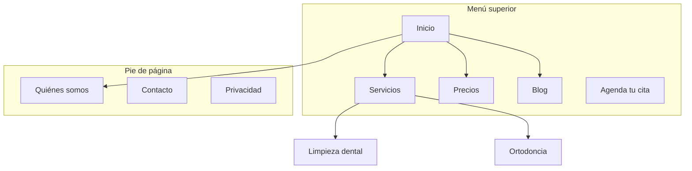

# Arquitectura del sitio web

Sirve para planear la estructura de un sitio (jerarquía de páginas, menú, direcciones y enlaces internos) de modo que la gente encuentre lo que busca y los buscadores lo entiendan.

Abarca el diseño de la estructura. Si el pedido es técnico (sitemap XML desactualizado, errores de rastreo en Search Console, indexación), no es esta habilidad: usa `auditoria-seo` y dilo.

## Antes de empezar

Lee las notas de la empresa en el Cerebro (`00-Empresa/perfil`, `00-Empresa/oferta`, `00-Empresa/clientes` y sobre todo `00-Empresa/marketing`) y las cifras de la empresa. Si falta algo que necesitas, pregúntalo en una línea o déjalo marcado como supuesto; nunca lo inventes. Pregunta solo lo que el Cerebro no responda.

Reúne este contexto:

### 1. El negocio
- ¿Qué hace la empresa?
- ¿Quiénes son los públicos principales?
- ¿Cuáles son los 3 objetivos principales del sitio? (ventas o contactos, tráfico desde buscadores, educar, dar soporte, reservas)

### 2. La situación actual
- ¿Sitio nuevo o reordenar uno existente?
- Si se reordena: ¿qué falla? (la gente se va enseguida, mal posicionamiento, nadie encuentra nada)
- ¿Hay direcciones existentes que deben conservarse o redirigirse?

### 3. El tipo de sitio
- Sitio de marketing de un SaaS o software
- Sitio de contenido o blog
- Tienda en línea (e-commerce)
- Documentación
- Híbrido (producto + contenido)
- Negocio pequeño o local (consultorio, restaurante, ferretería, despacho, taller)

### 4. Inventario de contenido
- ¿Cuántas páginas existen o se planean?
- ¿Cuáles son las más importantes (por visitas, conversiones o valor para el negocio)?
- ¿Hay secciones o ampliaciones planeadas (una sucursal nueva, un catálogo nuevo)?

Si la empresa tiene conectada su analítica web o Search Console, úsalas para saber qué páginas importan; si no, pídele al dueño la lista de páginas (o léela con la búsqueda web si está encendida).

---

## Tipos de sitio y punto de partida

| Tipo de sitio | Profundidad típica | Secciones clave | Patrón de dirección |
|---|---|---|---|
| Marketing de SaaS | 2-3 niveles | Inicio, Funciones, Precios, Blog, Documentación | `/funciones/nombre`, `/blog/slug` |
| Contenido / blog | 2-3 niveles | Inicio, Blog, Categorías, Quiénes somos | `/blog/slug`, `/categoria/slug` |
| Tienda en línea | 3-4 niveles | Inicio, Categorías, Productos, Carrito | `/categoria/subcategoria/producto` |
| Documentación | 3-4 niveles | Inicio, Guías, Referencia de API | `/docs/seccion/pagina` |
| Híbrido producto + contenido | 3-4 niveles | Inicio, Producto, Blog, Recursos, Documentación | `/producto/funcion`, `/blog/slug` |
| Negocio pequeño o local | 1-2 niveles | Inicio, Servicios, Quiénes somos, Contacto | `/servicios/nombre` |

Para las plantillas completas de cada tipo, lee la referencia `plantillas-por-tipo-de-sitio`.

---

## Diseño de la jerarquía

### La regla de los 3 clics
Cualquier página importante debería estar a 3 clics o menos de la página de inicio. No es absoluta, pero si páginas clave quedan a 4 o más niveles, algo está mal.

### Plano o profundo

| Enfoque | Ideal para | Costo |
|---|---|---|
| Plano (2 niveles) | Sitios pequeños, portafolios, negocios locales | Simple, pero no escala |
| Moderado (3 niveles) | La mayoría de SaaS y sitios de contenido | Buen equilibrio entre profundidad y facilidad para encontrar |
| Profundo (4+ niveles) | Tiendas grandes, documentación extensa | Escala, pero puede enterrar contenido |

**Regla práctica:** tan plano como sea posible sin que el menú se ensucie. Si un desplegable tiene más de 20 elementos, añade un nivel.

### Niveles

| Nivel | Qué es | Ejemplo |
|---|---|---|
| N0 | Página de inicio | `/` |
| N1 | Secciones principales | `/funciones`, `/blog`, `/precios` |
| N2 | Páginas de sección | `/funciones/analitica`, `/blog/guia-seo` |
| N3+ | Páginas de detalle | `/docs/api/autenticacion` |

### Formato de árbol en texto (ASCII)

```
Inicio (/)
├── Funciones (/funciones)
│   ├── Analítica (/funciones/analitica)
│   ├── Automatización (/funciones/automatizacion)
│   └── Integraciones (/funciones/integraciones)
├── Precios (/precios)
├── Blog (/blog)
│   ├── [Categoría: SEO] (/blog/categoria/seo)
│   └── [Categoría: Conversión] (/blog/categoria/conversion)
├── Recursos (/recursos)
│   ├── Casos de éxito (/recursos/casos)
│   └── Plantillas (/recursos/plantillas)
├── Documentación (/docs)
│   ├── Primeros pasos (/docs/primeros-pasos)
│   └── Referencia de API (/docs/api)
├── Quiénes somos (/nosotros)
│   └── Trabaja con nosotros (/nosotros/empleo)
└── Contacto (/contacto)
```

**Cuándo usar árbol de texto o Mermaid:**
- Árbol de texto: borradores rápidos, estructuras simples, cuando solo hay texto.
- Mermaid: para presentar, relaciones complejas, mostrar zonas del menú o patrones de enlaces.

---

## Diseño de la navegación

### Tipos de navegación

| Tipo | Para qué | Dónde |
|---|---|---|
| Menú superior | Navegación principal, siempre visible | Arriba en todas las páginas |
| Desplegables | Agrupan subpáginas bajo una principal | Se abren desde el menú superior |
| Pie de página | Enlaces secundarios, legales, mapa del sitio | Abajo en todas las páginas |
| Barra lateral | Navegar dentro de una sección (docs, blog) | A la izquierda dentro de la sección |
| Migas de pan | Dónde está uno en la jerarquía | Bajo el menú, sobre el contenido |
| Enlaces en contexto | Contenido relacionado, siguiente paso | Dentro del texto |

### Reglas del menú superior
- **4 a 7 elementos como máximo** (más genera parálisis al decidir).
- **El botón de acción** va a la derecha («Prueba gratis», «Agenda tu cita», «Cotiza», «Compra ahora»).
- **El logo** lleva al inicio (a la izquierda).
- **Orden por prioridad:** lo más importante o visitado primero.
- Con megamenú, 3-4 columnas como máximo.

### Pie de página
Agrupa los enlaces en columnas:
- **Producto / Servicios:** funciones o servicios, precios, integraciones, novedades
- **Recursos:** blog, casos, plantillas, documentación
- **Empresa:** quiénes somos, empleo, contacto, prensa, sucursales
- **Legal:** privacidad, términos, seguridad

### Migas de pan
```
Inicio > Funciones > Analítica
Inicio > Blog > Categoría SEO > Título del artículo
```
Deben reflejar la jerarquía de la dirección. Cada tramo es un enlace salvo la página actual.

Para patrones detallados (megamenú, menú dividido, pie ampliado, barras laterales, móvil, errores comunes), lee `patrones-de-navegacion`.

---

## Estructura de las direcciones (URL)

### Principios
1. **Legibles para personas:** `/funciones/analitica`, no `/f/a123`.
2. **Guiones, no guiones bajos:** `/blog/guia-seo`, no `/blog/guia_seo`.
3. **Reflejan la jerarquía:** la ruta coincide con la estructura del sitio.
4. **Barra final coherente:** elige con o sin `/` al final y aplícalo siempre.
5. **Siempre en minúsculas:** `/Nosotros` debe redirigir a `/nosotros`.
6. **Cortas pero descriptivas:** `/blog/como-mejorar-la-tasa-de-conversion-de-tu-pagina-de-aterrizaje` es demasiado; `/blog/conversion-landing` es mejor.
7. **Sin tildes ni eñes en la dirección:** `/diseno`, `/clinica`; evita caracteres que se codifican raro al compartir.

### Patrones por tipo de página

| Tipo de página | Patrón | Ejemplo |
|---|---|---|
| Inicio | `/` | `ejemplo.com` |
| Función | `/funciones/{nombre}` | `/funciones/analitica` |
| Servicio | `/servicios/{nombre}` | `/servicios/ortodoncia` |
| Precios | `/precios` | `/precios` |
| Artículo del blog | `/blog/{slug}` | `/blog/guia-seo` |
| Categoría del blog | `/blog/categoria/{slug}` | `/blog/categoria/seo` |
| Caso de éxito | `/clientes/{slug}` | `/clientes/ferreteria-lopez` |
| Documentación | `/docs/{seccion}/{pagina}` | `/docs/api/autenticacion` |
| Legales | `/{pagina}` | `/privacidad`, `/terminos` |
| Página de aterrizaje | `/{slug}` o `/lp/{slug}` | `/prueba-gratis`, `/lp/webinar` |
| Comparativa | `/comparar/{competidor}` o `/vs/{competidor}` | `/comparar/nombre-competidor` |
| Integración | `/integraciones/{nombre}` | `/integraciones/slack` |
| Plantilla | `/plantillas/{slug}` | `/plantillas/plan-de-marketing` |
| Sucursal o ciudad | `/sucursales/{ciudad}` | `/sucursales/guadalajara` |

### Errores comunes
- **Fechas en el blog:** `/blog/2024/01/15/titulo` no aporta y alarga. Usa `/blog/titulo`.
- **Anidar de más:** `/productos/categoria/subcategoria/item/detalle` es demasiado. Aplana donde se pueda.
- **Cambiar direcciones sin redirigir:** cada dirección vieja necesita una redirección 301 a la nueva. Sin ella se pierde la autoridad de los enlaces y quedan páginas rotas para quien la tenía guardada o enlazada.
- **Números de id:** `/producto/12345` no se lee. Usa un slug.
- **Parámetros para el contenido:** `/blog?id=123` debería ser `/blog/titulo`.
- **Patrones mezclados:** no combines `/funciones/analitica` con `/producto/automatizacion`. Elige un padre.

### Migas de pan alineadas con la dirección

| Dirección | Migas de pan |
|---|---|
| `/funciones/analitica` | Inicio > Funciones > Analítica |
| `/blog/guia-seo` | Inicio > Blog > Guía SEO |
| `/docs/api/autenticacion` | Inicio > Docs > API > Autenticación |

---

## Mapa visual (Mermaid)

Usa Mermaid `graph TD` para mapas visuales; deja clara la jerarquía y puede marcar zonas del menú.



Para más plantillas (con direcciones, centro y radios, flujo de enlaces, antes/después, colores por estado), lee `plantillas-mermaid`.

---

## Estrategia de enlaces internos

### Tipos de enlace

| Tipo | Para qué | Ejemplo |
|---|---|---|
| De navegación | Moverse entre secciones | Menú, pie, barra lateral |
| En contexto | Contenido relacionado dentro del texto | «Conoce más de [nuestra analítica](/funciones/analitica)» |
| Centro y radios | Unir un grupo de contenidos con su página central | Artículos que enlazan a la guía principal |
| Entre secciones | Unir páginas relacionadas de secciones distintas | Una función que enlaza a su caso de éxito |

### Reglas
1. **Ninguna página huérfana:** toda página recibe al menos un enlace interno.
2. **Texto del enlace descriptivo:** «nuestros servicios de ortodoncia», no «clic aquí».
3. **Orientación: 5 a 10 enlaces internos por cada 1.000 palabras.**
4. **Enlaza más a lo importante:** inicio, servicios o funciones clave, precios.
5. **Migas de pan:** son enlaces internos gratis en cada página.
6. **Secciones de relacionados:** «Artículos relacionados» o «También te puede interesar» al final.

### Modelo de centro y radios (hub and spoke)
```
Centro: /blog/guia-seo (panorama completo)
├── Radio: /blog/investigacion-palabras-clave (enlaza de vuelta al centro)
├── Radio: /blog/seo-en-pagina (enlaza de vuelta al centro)
├── Radio: /blog/seo-tecnico (enlaza de vuelta al centro)
└── Radio: /blog/enlaces-externos (enlaza de vuelta al centro)
```
Cada radio enlaza al centro; el centro enlaza a todos los radios; los radios se enlazan entre sí donde tenga sentido.

### Lista de revisión de enlaces
- [ ] Cada página recibe al menos un enlace interno
- [ ] No hay enlaces internos rotos (404)
- [ ] El texto de los enlaces es descriptivo (no «clic aquí» ni «leer más»)
- [ ] Las páginas importantes son las que más enlaces internos reciben
- [ ] Hay migas de pan en todas las páginas
- [ ] Los artículos del blog tienen enlaces a contenido relacionado
- [ ] Hay enlaces entre secciones: funciones o servicios con casos de éxito, blog con páginas de producto

### Contenido a escala (páginas programáticas)
Cuando se suman decenas o cientos de páginas (integraciones, comparativas, ciudades): dales una página central por sección (`/integraciones`, `/comparar`), enlázalas con centro y radios, no las metas en el menú principal (como mucho, el centro va en el pie), y cuida el presupuesto de rastreo: que cada una tenga contenido propio y esté enlazada. La estrategia de esas páginas es de `seo-programatico`.

---

## Cómo entregarlo

Una respuesta en Markdown con estas cinco partes:

### 1. Jerarquía de páginas (árbol de texto)
La estructura completa con la dirección en cada nodo, en el formato de arriba.

### 2. Mapa visual (Mermaid)
`graph TD` con las relaciones y, donde ayude, subgrafos por zona del menú. Si es una reestructuración, incluye el antes y el después.

### 3. Tabla de direcciones

| Página | Dirección | Padre | Ubicación en el menú | Prioridad |
|---|---|---|---|---|
| Inicio | `/` | — | Menú superior | Alta |
| Servicios | `/servicios` | Inicio | Menú superior | Alta |
| Ortodoncia | `/servicios/ortodoncia` | Servicios | Desplegable | Media |
| Precios | `/precios` | Inicio | Menú superior | Alta |
| Blog | `/blog` | Inicio | Menú superior | Media |

### 4. Especificación de la navegación
- Menú superior (en orden, con el botón de acción)
- Pie de página por columnas
- Barra lateral (si aplica)
- Notas para las migas de pan

### 5. Plan de enlaces internos
- Páginas centrales y sus radios
- Oportunidades de enlaces entre secciones
- Páginas huérfanas (si se reestructura)
- Enlaces recomendados por página clave

Si se mueven páginas, añade una **tabla de redirecciones** (dirección vieja → nueva, 301). Cierra con los supuestos que hiciste y las preguntas abiertas para el dueño. Si hace falta que otro departamento haga algo (por ejemplo, quien mantiene la web), propónlo con `crear_borrador_tarea`.

## Preguntas para el pedido
1. ¿Sitio nuevo o reestructuración?
2. ¿Qué tipo de sitio es? (SaaS, contenido, tienda, documentación, híbrido, negocio local)
3. ¿Cuántas páginas existen o se planean?
4. ¿Cuáles son las 5 páginas más importantes?
5. ¿Hay direcciones que deban conservarse o redirigirse?
6. ¿Quiénes son los públicos principales y qué quieren lograr en el sitio?

## Reglas
- Nunca inventes visitas, posiciones ni cifras de tráfico; si no tienes datos, dilo.
- Toda página que cambie de dirección lleva su redirección 301 en la entrega.
- Máximo 7 elementos en el menú superior.
- Ninguna página importante a más de 3 clics del inicio sin justificarlo.
- Direcciones en minúsculas, con guiones, sin tildes, sin fechas ni ids.
- Entregas un plan: no cambias el sitio ni publicas nada; los cambios los aprueba el dueño.
- Lo técnico (sitemap XML, rastreo, indexación) va a `auditoria-seo`.

## Referencias
- `plantillas-por-tipo-de-sitio` — léela al empezar un sitio de un tipo concreto: árbol, tabla de direcciones y menú para SaaS, contenido, tienda, documentación, híbrido y negocio local.
- `patrones-de-navegacion` — léela al diseñar el menú, el pie, la barra lateral, las migas de pan o la versión móvil, y para revisar errores comunes.
- `plantillas-mermaid` — léela cuando el mapa visual tenga zonas de menú, centro y radios, flujo entre secciones, antes/después o colores por estado.

## Habilidades relacionadas
- `estrategia-contenido`: qué contenido crear y los grupos de temas.
- `seo-programatico`: páginas de SEO a escala con plantillas y datos.
- `auditoria-seo`: SEO técnico, en página e indexación.
- `conversion-paginas`: optimizar páginas concretas para que conviertan.
- `datos-estructurados`: marcado de migas de pan y navegación.
- `paginas-comparativas`: marcos y direcciones para las páginas de comparación.
