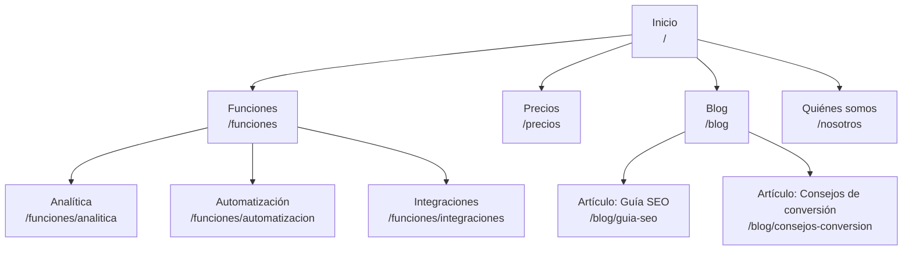
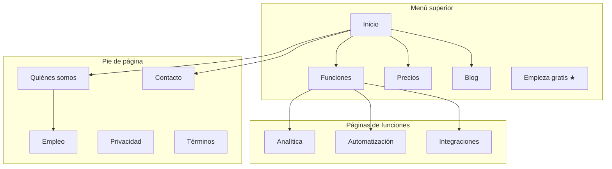
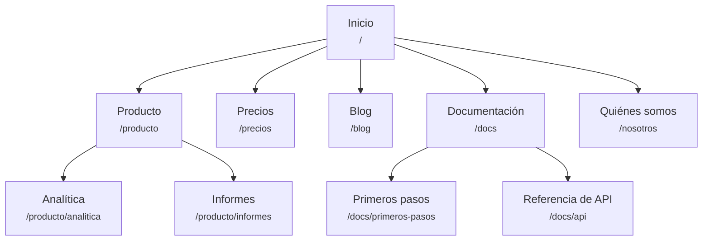
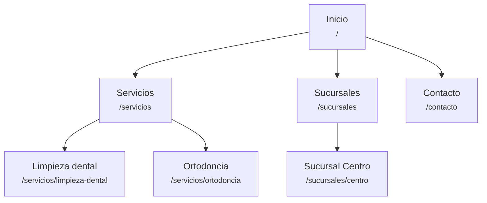
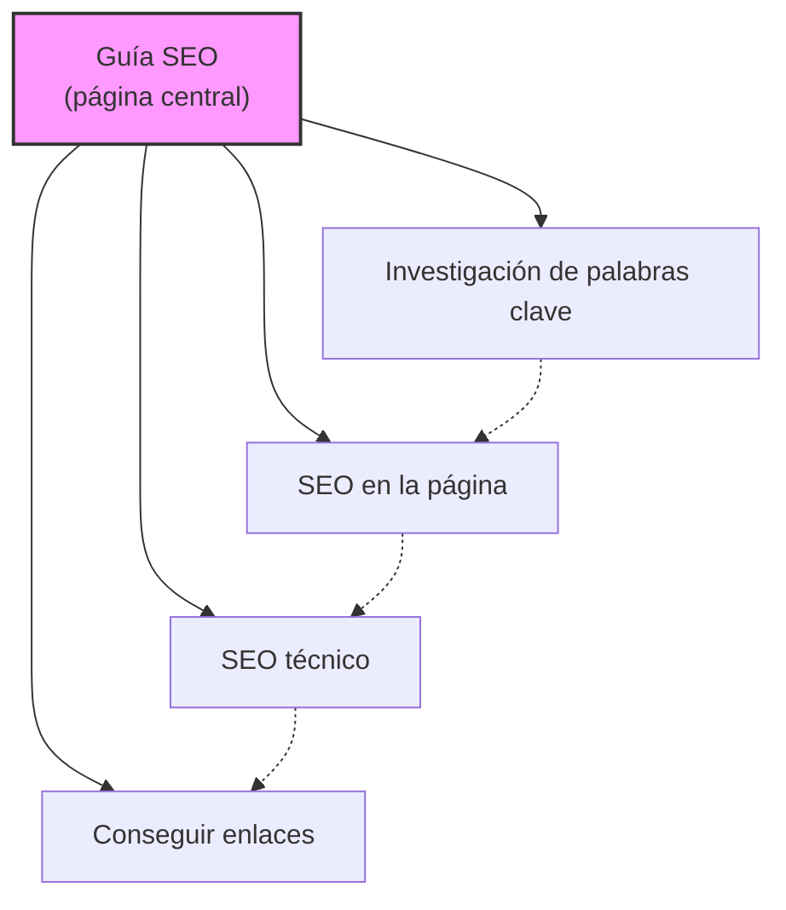
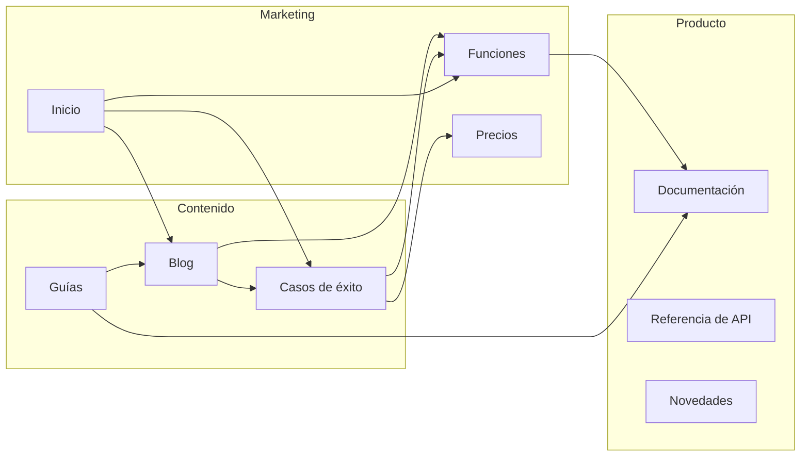
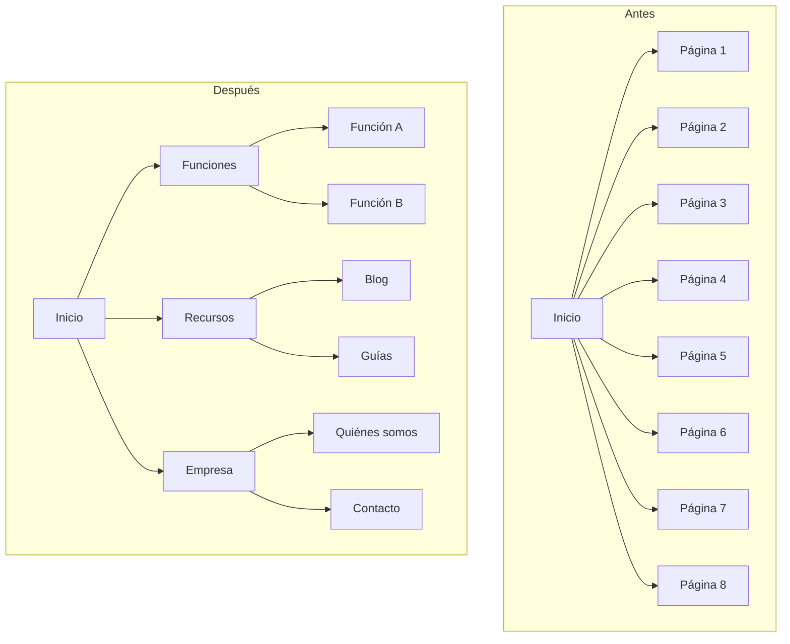
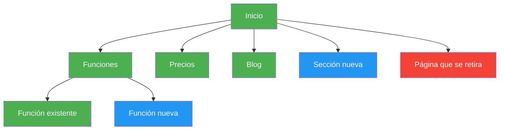

# Plantillas de diagramas Mermaid

Diagramas listos para copiar como mapa visual del sitio. Cambia los nombres de los nodos y las conexiones según el sitio de la empresa.

---

## Jerarquía básica

Jerarquía simple de arriba abajo.

---

## Jerarquía con zonas de navegación

Usa subgrafos para mostrar qué páginas van en cada zona del menú.

---

## Jerarquía con direcciones

Cada nodo muestra el nombre y la dirección.

Para un negocio local, el mismo esquema con servicios:

---

## Modelo de centro y radios

Una página central unida a sus artículos radio, que también se enlazan entre sí.

Leyenda:
- Líneas continuas = enlaces principales centro-radio
- Líneas discontinuas = enlaces cruzados entre radios

---

## Flujo de enlaces internos

Cómo se enlazan entre sí las secciones del sitio.

---

## Antes y después de reestructurar

Compara la estructura actual con la propuesta, lado a lado.

---

## Colores por estado

Usa estilos para marcar el estado, la prioridad o el tipo de página.

Clave de colores:
- **Verde** (`#4CAF50`): páginas que ya existen (sin cambios)
- **Azul** (`#2196F3`): páginas nuevas por crear
- **Rojo** (`#f44336`): páginas que se quitan o redirigen
- **Amarillo** (`#FFC107`): páginas que se reestructuran o mueven
- **Morado** (`#9C27B0`): páginas de alta prioridad o de acción (contacto, compra, reserva)

Cuando uses colores, pon siempre la clave debajo del diagrama: quien lo lea no tiene por qué saber qué significa cada color.
