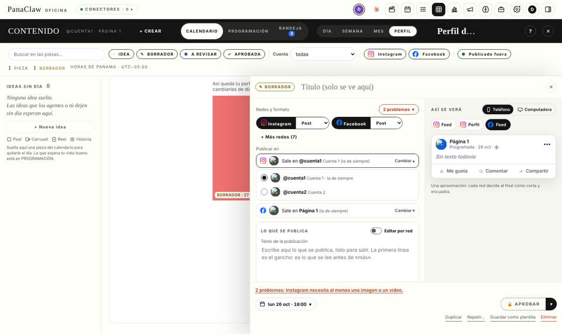
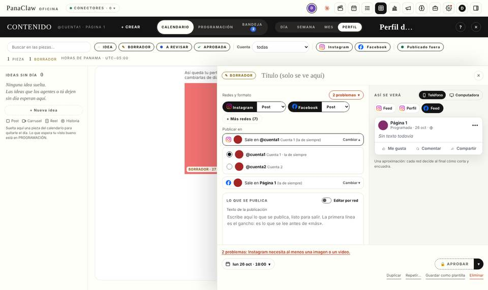
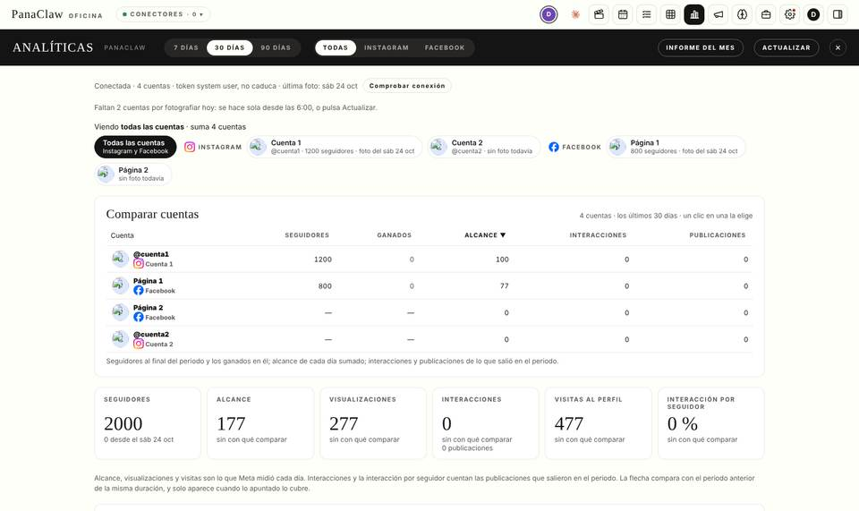
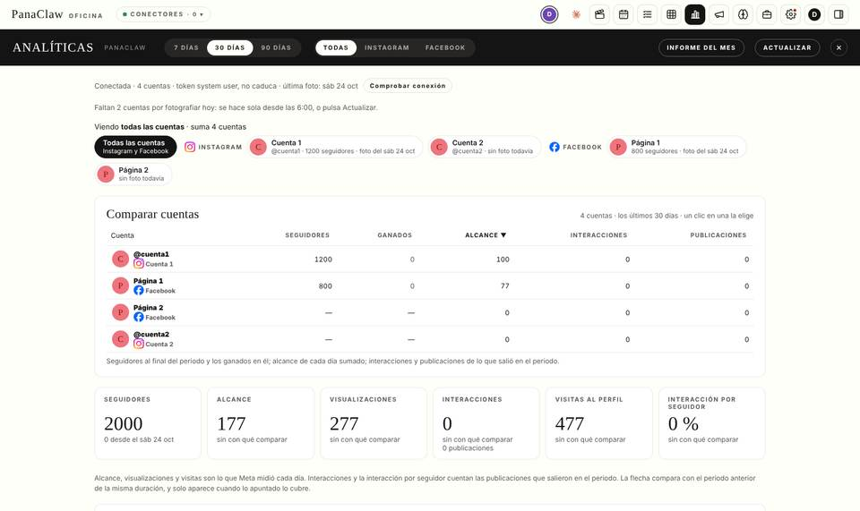

# Auditoría de CSP de la oficina en la nube (25 oct 2026)

Pedido del dueño: en la nube, las fotos de perfil de las 8 cuentas salían como imagen rota en Analíticas (y después, en el editor de una pieza). «En local sí cargaban.»

## Cómo se midió

La oficina real (`dist/`, la misma página que en local) en **Chromium de verdad**, con las cabeceras **reales** de `cloudflare/public/_headers` y el Worker real (`manejar`, con D1 y R2 en memoria y el Meta de mentira de `tests/meta-stand.mjs`; ninguna petición sale a la red). Se escuchan `securitypolicyviolation`, la consola, `requestfailed` y las respuestas ≥ 400, y después de cada paso se cuentan las `` visibles que terminaron de cargar sin ancho. Datos de ejemplo: 2 páginas de Facebook y 2 Instagram con foto, 3 publicaciones con miniatura, comentarios y un mensaje privado, 4 campañas con creativo, un borrador de campaña, una foto en la galería del Estudio y una pieza con imagen.

Se repite con `node cloudflare/scripts/auditoria-csp.mjs` (`--antes <nube.js viejo>` para medir cómo estaba; `--capturas <carpeta>`), y queda como prueba: `cloudflare/tests/csp-oficina.test.mjs`.

**Causa confirmada:** la CSP de la oficina (`img-src 'self' data: blob:`) bloquea cualquier `` que apunte a `fbcdn.net` / `cdninstagram.com`; la oficina local no tiene CSP. Las miniaturas de publicaciones del calendario de Contenido y de Analíticas ya iban por `/api/contenido/miniatura/<hash>` (copia en R2) y por eso sí cargaban; las fotos de cuenta no.

## Lo bloqueado o roto, antes y después

Vistas recorridas: Oficina (inicio), Analíticas, Contenido (calendario, editor de una pieza nueva con sus vistas previas, una pieza con imagen, Programación, Bandeja, Perfil), Anuncios (resumen, campañas, detalle y borradores con la vista previa de Meta, creativos, sugerencias), Estudio (galería y visor), Cerebro, Tareas, calendario de tareas, Dimitri, Ajustes (apariencia, cuentas y roles, contenido), Estado, Negocio y Costos, y, sin sesión, el acceso y la invitación.

| # | Vista | Recurso | Regla de CSP que lo bloquea | Antes | Después |
|---|---|---|---|---|---|
| 1 | Analíticas | foto de perfil de cada cuenta (IG y FB): chips «Viendo», selector de cuenta, tabla **Comparar cuentas** | `img-src 'self' data: blob:` | 4 bloqueadas, 4 `` rotas | 0 (por `/api/imagen-meta`) |
| 2 | Contenido → editor de una pieza | fila **Publicar en** (la cuenta elegida), la lista **Cambiar** (las 4 de Instagram, la de Facebook) | `img-src` | 3 bloqueadas, rotas | 0 |
| 3 | Contenido → editor, vista previa (IG Feed / Perfil, FB Feed; teléfono y computadora) | avatar de la cuenta en la maqueta | `img-src` | rota (`pieza.js`, `contenido-preview.js`) | 0 |
| 4 | Contenido → Bandeja | miniatura de la publicación de cada comentario (`bj-pub`) | `img-src` | bloqueada, rota | 0 |
| 5 | Anuncios → Creativos / detalle | miniatura del creativo de cada anuncio (`thumbnail_url` de Meta) | `img-src` | bloqueada | 0 |
| 6 | Anuncios → Borradores → «Ver la de Meta» | marco `https://www.facebook.com/ads/api/preview_iframe.php` | sin `frame-src` ⇒ cae en `default-src 'self'` | **bloqueado** (el recuadro quedaba en blanco) | permitido, solo ese origen y esa ruta |
| 7 | Contenido → editor de una pieza nueva | `GET /api/media/plantillas` → 501 | (no es CSP) el Estudio de plantillas aún no está portado (fase 8b); contesta 501 en español | 501 | 501 (se queda; es el aviso de «no portado») |
| 8 | Todas | fuentes web | `font-src 'self' data:` | sin hallazgos (las tipografías van incrustadas en la página) | igual |
| 9 | Todas | `connect-src 'self'`, `media-src`, `worker-src`, scripts/estilos en línea | — | sin hallazgos (en este banco el WebSocket `/api/live` no abre porque el proxy de la máquina de pruebas no deja túneles `wss`; no es CSP) | igual |
| 10 | Acceso, invitación | CSP estricta (sin scripts ni estilos en línea) | — | sin hallazgos | igual |
| 11 | Estudio, Cerebro, Tareas, Calendario, Dimitri, Ajustes, Estado, Negocio, Costos | — | — | sin hallazgos | igual |

Las únicas peticiones a un tercero que la página hace con esta CSP son la vista previa de anuncios de Meta (permitida a propósito, fila 6); `script-src`, `connect-src` y `img-src` no abrieron ningún host.

## Cómo se arregló

- **Proxy de imágenes de Meta** (`GET /api/imagen-meta?u=…`, `cloudflare/worker/lib/imagen-meta.js` y `modulos/imagen-meta.js`): lista blanca de hosts de CDN de Meta, https, sin credenciales ni puertos raros, redirecciones validadas, solo imágenes (por sus bytes), 5 MB, `sandbox` + `nosniff`, caché de navegador de un día y copia en R2, ritmo por persona. Detalle y límites: `docs/cloudflare.md` → «Las imágenes de Meta y la CSP».
- **`cloudflare/public/nube.js`** reescribe a ese proxy toda imagen de esos hosts, también las que la página pinta después. La página local no cambia.
- **`frame-src`** solo para la vista previa de anuncios de Meta (`_headers`); `img-src` no suma ningún host.

## Pruebas

`cloudflare/tests/imagen-meta.test.mjs` (el proxy: `evilfbcdn.net`, `fbcdn.net.evil.com`, `http://`, `user@host`, IP, puertos, redirección a un host externo, no imagen, SVG con script, más de 5 MB, sin sesión 401, ritmo, caché, nada de URLs en el registro), `imagen-meta-navegador.test.mjs` (nube.js en Chromium por los siete caminos de pintar una imagen), `csp-oficina.test.mjs` (la oficina entera) y `contenido-siglas.test.mjs` (los logos de red, con axe).

## Capturas (antes y después)

| Antes | Después |
|---|---|
|  |  |
|  |  |

(El «después» usa fotos de ejemplo de 1 px que el Meta de mentira entrega; en producción son las de las cuentas.)

